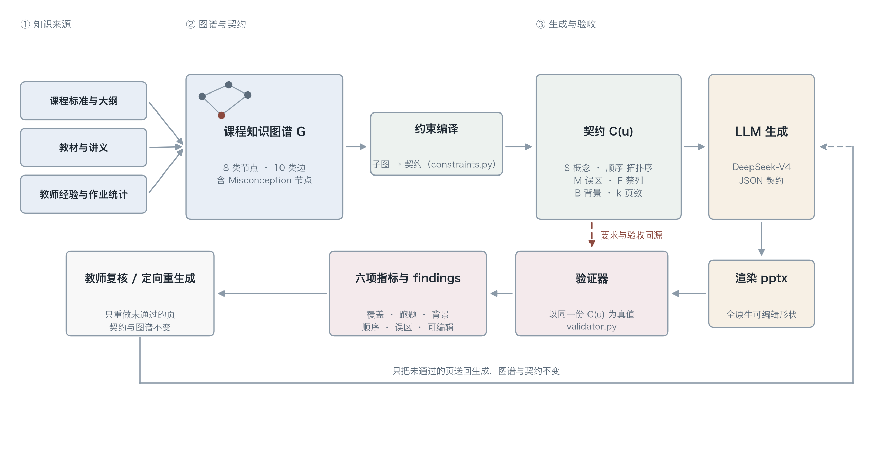

# kgslide · 知识图谱约束的课件生成

> 用课程知识图谱约束大模型生成课件，让每一页都有据可依、顺序讲得通、错误有人管。

大多数「AI 生成 PPT」的做法是把文档丢给模型，让它自由发挥。结果通常是：内容看着像，但漏掉关键知识点、顺序颠倒、把学生常见的错误又讲了一遍。

本项目换一个思路：**先把课程建成知识图谱，再让图谱约束生成**。

- 每个讲次生成哪几个概念，由图谱的 `appears_in` 和 `importance` 决定
- 讲解顺序由 `prerequisites_for` 的拓扑序强制约束，不会先讲队满再讲队空
- 学生的高频误区作为一等公民建模（`Misconception` 节点），生成时必须产出纠错内容
- 生成完自动回验，六项指标量化「讲没讲全、有没有跑题、顺序对不对、老师能不能改」



关键设计是**约束即数据**：`UnitConstraints` 同时驱动提示词构造与后验校验，
所以「要求什么」和「检查什么」不会漂移。这也是它区别于「把知识点写进提示词」的地方——
提示词用完就扔，契约是数据对象，生成前后都能被程序读。

## 实验结果

在高职《Python 数据结构》队列模块的 3 个讲次上，6 种条件 × 3 次重采样（每个条件 n=9），
外加 3 组消融。均值（标准差）：

| 条件 | 覆盖率 ↑ | 跑题 ↓ | 顺序违例 ↓ | 误区覆盖 ↑ | 输出 tok |
| --- | :-: | :-: | :-: | :-: | :-: |
| **full（本文）** | **0.981** (0.056) | **0.000** | 0.020 (0.045) | **1.000** (0.000) | 4079 |
| rag_mc（给误区文本，无结构） | 0.698 (0.295) | 0.111 (0.220) | 0.007 (0.022) | 0.556 (0.527) | 2689 |
| rag（教材片段） | 0.659 (0.248) | 0.111 (0.220) | 0.030 (0.089) | 0.222 (0.441) | 2378 |
| placebo（与 full 等长的提示） | 0.675 (0.266) | 0.167 (0.250) | 0.096 (0.131) | 0.333 (0.500) | 1444 |
| cot（思维链） | 0.614 (0.185) | 0.019 (0.056) | 0.089 (0.183) | 0.389 (0.486) | 2638 |
| zero_shot（直出） | 0.643 (0.248) | 0.019 (0.056) | 0.037 (0.089) | 0.222 (0.441) | 2330 |

三件值得注意的事：

1. **覆盖率增益不是「提示更长」造成的。** 等长的 `placebo` 组把提示撑到与 `full` 相当
   （U11 上 2195 对 1997 字符）但只填通用写作建议，覆盖率仍是 0.675。
2. **误区这一项，方差比均值更重要。** `rag_mc` 拿到了同样的误区文本，均值 0.556、
   标准差 0.527——9 次里只稳定成功一半。`full` 是 1.000 ± 0.000。
   知识图谱改变的不是平均质量，而是可靠性。
3. **顺序约束没有可靠贡献。** `full` 0.020 对 `zero_shot` 0.037，消融甚至方向相反。
   强模型对教科书内容的顺序本来就有把握。这是负结果，照实报。

完整表格、消融、成本与逐讲次数据见 [`paper/tables.md`](paper/tables.md)，
实验口径见 [`docs/experiment.md`](docs/experiment.md)。

单次生成产出一份可直接编辑的 `.pptx`（13.33×7.5，16:9），
在 PowerPoint、Keynote、WPS 里都能改字改版。

## 安装

```bash
git clone <your-repo-url>
cd kg-slidegen
python3 -m venv .venv
source .venv/bin/activate
pip install -e ".[dev]"
```

需要 Python 3.10+。

## 快速开始

### 1. 先看图谱长什么样

```bash
kgslide info
kgslide check-graph
```

`check-graph` 会跑结构校验：悬空边、先修成环、节点未锚定讲次、语义边缺证据、讲次概念数越界。

### 2. 查看某个讲次的生成约束

```bash
kgslide inspect --unit U11
```

输出就是这个讲次交给模型的完整契约：必须覆盖什么、按什么顺序、要纠正哪条误区、哪些概念只能一句话带过。

### 3. 离线跑通全流程（不花钱、不需要 key）

```bash
kgslide generate --unit U11 --mock
```

会在 `outputs/` 下生成 `U11.pptx` 并打印六项指标。mock 模式完全确定性，适合调试和写论文时的流程验证。

### 4. 接入真实模型

```bash
export DEEPSEEK_API_KEY=sk-xxxxxxxx
kgslide generate --unit all --out outputs --summary outputs/summary.json
```

默认走 DeepSeek 的 OpenAI 兼容接口。

**模型选择**

| 模型 ID | 说明 | 适用场景 |
| --- | --- | --- |
| `deepseek-v4-flash` | 默认，单价低 | 批量生成、日常迭代 |
| `deepseek-v4-pro` | 推理更强，单价约为 flash 的 3 倍 | 复杂讲次、终稿 |

> `deepseek-chat` 与 `deepseek-reasoner` 已于 2026-07-24 废弃，现仅作为兼容别名保留。旧代码里写这两个名字仍能跑，但新项目建议直接用 v4 系列。

**关于「思考模式」**：实测（2026-11）`deepseek-v4-flash` **默认会产生 `reasoning_tokens`**，即调用本身就带一轮内部推理。这一点必须显式记录——否则 CoT 基线会被污染（模型本来就在做 CoT，你再让它写推理步骤就测不出差别）。配置 `LLMConfig(thinking="disabled")` 可关闭，`bench` 会用 `--thinking` 参数把该设置写进结果文件。

成本估算：一次 8 页课件的输入约 2K tokens、输出约 3K tokens（思考模式下另含 1–3K reasoning tokens），按 v4-flash 当前价折算每套不足 1 分钱，全课程 34 讲约三毛。`bench` 会把每次调用的 token 与耗时写进 `results.csv`，可直接做论文的成本表。具体价格以[官方定价页](https://api-docs.deepseek.com/quick_start/pricing)为准。

**JSON 模式的两个坑**（代码里已处理）

1. DeepSeek 的 JSON 模式要求提示词中出现 `json` 字样并给出样例，否则可能返回空内容。
2. 输出无法解析为 JSON 时，接口会把非法片段替换成空格，`content` 可能只有空白且 `finish_reason` 仍是 `stop`。`llm.py` 检测到空内容会自动重试并追加格式提醒，重试两次仍失败才抛错。

## 图谱结构

`data/kg_pyds_m4.json` 是 M4「队列」模块的完整图谱（34 节点 / 75 边），格式遵循 `schema.yaml`。

**8 类节点**：`Course` · `Module` · `Unit` · `Concept` · `Skill` · `Lab` · `Exercise`（以上 7 类沿用 K12-KGraph）· `Misconception`（本文扩展）

Schema 沿用 [K12-KGraph](https://github.com/haolpku/K12-KGraph)（NeurIPS 2026 Evaluations & Datasets Track），并扩展三处：

| 扩展 | 理由 |
| --- | --- |
| `Misconception` 节点 | 职教场景下纠错比讲授更有效，原 schema 无法表达这一教学要素 |
| `implements` 边（概念→代码） | 编程课的知识落点是代码，需显式建模，并用于检查生成内容的可执行性 |
| `addresses_misconception` 边 | 让图谱能约束生成器产出针对性纠错内容 |

**10 类边**：`is_a` · `prerequisites_for` · `relates_to` · `implements` · `verified_by` · `assessed_by` · `addresses_misconception` · `appears_in` · `is_part_of` · `leads_to`

## 工作流

```
单元子图 ──► 约束契约 ──► LLM 生成 ──► 渲染 pptx ──► 回验证
   │            │            │            │           │
 graph.py  constraints.py  llm.py    renderer.py  validator.py
```

关键设计：**约束是数据，不是提示词**。`UnitConstraints` 同时驱动生成和校验，保证「要求」和「验收」用的是同一份定义。

## 指标定义

| 指标 | 计算方式 |
| --- | --- |
| `coverage_rate` | 已覆盖的必需概念 / 必需概念总数 |
| `oog_rate` | 图谱外概念与禁用概念 / 总提及概念数 |
| `background_rate` | 作为回顾引用的兄弟讲次概念**字数** / 全文总字数（上限 25%） |
| `prerequisite_violation` | 违反拓扑序的概念对 / 概念对总数 |
| `misconception_coverage` | 已纠正的误区 / 该讲次关联的误区总数 |
| `editability` | 原生可编辑形状 / 全部形状 |

中文没有词边界，`队列` 会匹配到 `循环队列` 里。因此文本级检测使用 `_net_occurrences`：先统计原始出现次数，再扣除出现在更长术语内部的次数，避免虚高。

**顺序按文字出现位置判定，不按模型自报的 `concept_ids`。** 三个基线组根本没被告知存在这个字段，若用自报结果计分，一个完全空白的答卷会因为「没有报告」而拿到 0 违例率——这是把漏答当成满分。改成扫描每页文字、取每个概念首次出现的位置，指标才对所有条件可比。

背景引用按**字数占比**而非概念个数计算。一页对比表同时点名三个兄弟概念是正常教学，按个数计会误报；按篇幅计才反映「有没有跑题」。

误区覆盖采用三重判定：结构锚点（误区页是否引用了图谱关联到该误区的概念）→ 英文标识符重叠（`rear`、`list`）→ 中文字符 bigram 重叠（阈值 0.35）。只用字面匹配会漏判，因为模型常用自己的话重述错误说法。

`forbidden` 与 `siblings` 互斥：前者计入跑题，后者计入背景回顾，同一个词同时出现在两边会让两个指标互相打架。测试里有断言守着这条。

## 实验条件

`bench` 支持 9 种条件。六个对照用来回答「图谱有没有用」，三组消融用来回答「图谱的哪一部分在起作用」：

| 条件 | 给模型的信息 |
| --- | --- |
| `full` | 完整契约：概念表 + 拓扑序 + 误区 + 禁止词 + 背景上限 |
| `rag_mc` | 教材片段 + 误区文本，但无任何结构（误区结论的控制组） |
| `rag` | 教材片段（概念名 + 定义），无结构信息 |
| `placebo` | 与 `full` **等长**的提示，但只填通用写作建议（长度效应的控制组） |
| `cot` | 零样本 + 要求在 notes 中先说明定位 |
| `zero_shot` | 只给课程名、讲次名、页数 |
| `no_order` | 完整契约，删掉拓扑序 |
| `no_misconception` | 完整契约，删掉误区 |
| `no_forbidden` | 完整契约，删掉禁止词 |

```bash
# 主表：6 组对照 × 3 讲次 × 3 次重采样
python -m kgslide.bench --units U10,U11,U12 \
  --modes full,rag_mc,rag,placebo,cot,zero_shot --repeat 3 --out outputs/main_v1

# 消融：拆掉图谱的一部分，看对应指标是否随之下降
python -m kgslide.bench --units U10,U11,U12 \
  --modes full,no_order,no_misconception,no_forbidden \
  --repeat 2 --out outputs/bench_ablation

# 改了指标口径后重新计分，不调用 API（省钱，且与原始输出严格对应）
python -m kgslide.bench --units U10,U11,U12 \
  --modes full,rag_mc,rag,placebo,cot,zero_shot --repeat 3 \
  --out outputs/main_v1 --reuse
```

`--repeat` 不是可有可无的：`full` 的单次覆盖率必然是 1.0（提示词里就是那份清单），单次数字证明不了什么。**跨重采样的方差**才是证据——如果约束真的起作用，`full` 的方差应该显著小于 `zero_shot`。

## 目录结构

```
kg-slidegen/
├── data/kg_pyds_m4.json      # 课程图谱（M4 队列模块）
├── src/kgslide/
│   ├── graph.py              # 加载、查询、DAG 校验、拓扑排序
│   ├── constraints.py        # 单元子图 → 生成契约
│   ├── llm.py                # DeepSeek 客户端 + 确定性 mock + 9 种实验条件
│   ├── renderer.py           # python-pptx 渲染
│   ├── validator.py          # 六项指标回验
│   ├── bench.py              # 对照与消融实验批量运行
│   └── cli.py                # 命令行入口
├── docs/experiment.md        # 实验方案与指标口径（改代码前先看这份）
├── paper/
│   ├── draft-zh.md           # 论文中文稿（投稿用英文稿见 draft-en.md）
│   ├── draft-en.md           # 论文英文稿（Markdown 版）
│   ├── latex/                # KBS 投稿用 LaTeX（elsarticle）+ 四个成品 PDF
│   ├── tables.py             # 从 results.csv 生成论文表格
│   └── figures/              # framework、graph_contract、graphical_abstract
├── tests/                    # 24 项测试
├── config/default.yaml
└── schema.yaml               # 形式化 schema 定义（见 kg-design/）
```

重新生成插图（默认出中文版；`--lang en` 出英文版，`--lang both` 两套都出）：

```bash
python paper/figures/make_fig1.py --lang both
python paper/figures/make_fig2.py --lang both
python paper/figures/make_graphical_abstract.py   # 图形摘要（仅英文，投稿用）
```

## 编译论文 PDF

`paper/latex/` 用 Elsevier 官方 `elsarticle` 文档类（《Knowledge-Based Systems》
投稿模板），一次编译产出三个文件：

```bash
cd paper/latex && ./build.sh
```

| 文件 | 用途 |
| --- | --- |
| `manuscript.pdf` | 审稿版：`[review,12pt]`，双倍行距 + 行号，38 页 |
| `manuscript-preprint.pdf` | 预印本版：`[preprint,12pt]`，单倍行距无行号，27 页 |
| `highlights.pdf` | Highlights 独立页，5 条、每条 ≤85 字符（Elsevier 硬性要求） |
| `graphical_abstract.pdf` | 图形摘要，由 `paper/figures/make_graphical_abstract.py` 生成后自动复制进来 |

依赖：TeX Live / TinyTeX，需含 `elsarticle`、`elsarticle-num.bst`、`tabularx`、
`ragged2e`、`lineno`、`booktabs`、`caption`。参考文献用 BibTeX（`refs.bib`），
编号制；构建脚本会顺带报告 overfull hbox 数量，当前两个版本均无 >4pt 溢出。

## 图形摘要

Elsevier 把图形摘要缩到 **500 × 200 px**（2.5:1）显示，所以这张图不是 Figure 1
的缩略版，而是重画：**四步编号流程**（① 课程图谱 —compile→ ② 一份契约 —prompt→ ③ 模型 —render→ ④ 可编辑课件）
加一条虚线旁路表示"同一份契约兼作验收标准"，下方三组结果，末句收束。
正文字号全部 ≥12 pt，缩到缩略图仍能读出主干与先后顺序。

产出 `paper/figures/graphical_abstract.pdf`（矢量）与 `.png`（3990 × 1596 px，
即 300 dpi 下 13.3 × 5.32 英寸，为下限 1328 × 531 的 3 倍）。合规项：

- 比例 2.5:1，PDF 页面 33.78 × 13.51 cm；
- 只用 Arial，TrueType（`pdf.fonttype=42`）嵌入，不是出版社不收的 Type 3；
- 图内不含 “Graphical Abstract” 标题、不含图外文字；
- 脚本自带排版审计：任何文字越界或相互重叠都会直接报错。


## 测试

```bash
pytest -q --basetemp="$(mktemp -d)"
```

`--basetemp` 不是必需的，但如果你在沙箱或受限环境里跑过 pytest、留下了残留的临时目录，
默认的 `/tmp/pytest-of-*` 可能因 EEXIST 报错——换一个干净目录即可，与测试本身无关。

覆盖：图谱结构合法性、环检测、拓扑序、约束切分、mock 渲染、指标边界、顺序违例与漏讲检测，
以及**七项防回归守门**——分别锁住 `docs/experiment.md` 里那七处会让指标偏袒约束方法的缺陷
（自报 ID、预览页、前向引用、跨行抵消、逐字匹配、误区锚点、图谱外判定）。

## 路线图

- [ ] 补齐 M1–M8 全部模块（当前只有 M4）
- [ ] 支持从教材 PDF 半自动建图（参考 SciMKG 的抽取—校验—整合管线）
- [ ] 加入渲染回看闭环：截图 → VLM 检查溢出与重叠 → 自动修正
- [ ] 发布中文职教课件评测集，供同类工作横向对比

## 引用

如果你在论文中使用本项目，请引用：

```bibtex
@software{kgslide2026,
  title  = {kgslide: Knowledge-Graph-Constrained Courseware Generation},
  author = {Liu, Suxing},
  year   = {2026},
  url    = {https://github.com/<your-account>/kg-slidegen}
}
```

## License

MIT，见 [LICENSE](LICENSE)。
