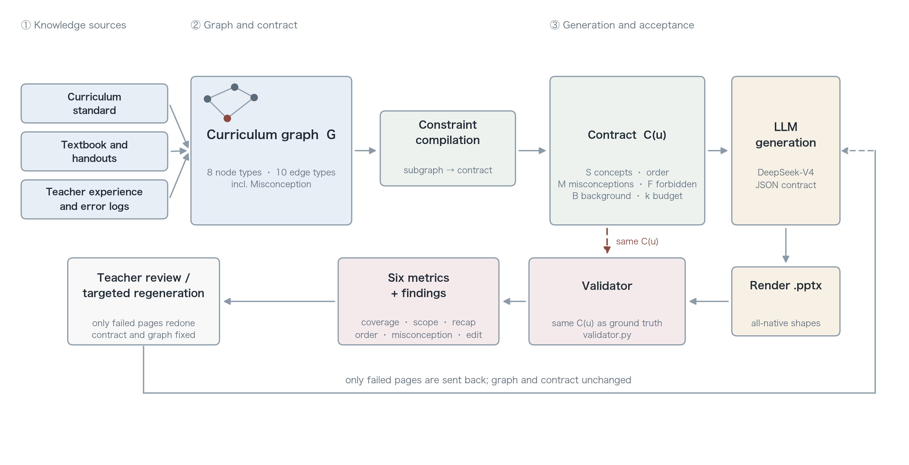

# kgslide · knowledge-graph-constrained courseware generation

> Constrain an LLM with a course knowledge graph so that every page is grounded,
> the teaching order holds, and student misconceptions are actually addressed.

Most "AI-generated slides" pipelines hand a document to a model and let it improvise.
The result usually looks plausible but drops key concepts, teaches topics out of order,
and sometimes restates the very error students make.

This project takes a different route: **model the course as a knowledge graph first,
then let the graph constrain generation.**

- which concepts a lecture covers is decided by the graph's `appears_in` and `importance`
- the teaching order is forced by the topological order of `prerequisites_for`, so
  "queue full" cannot be taught before "queue empty"
- students' recurring misconceptions are first-class nodes (`Misconception`), and the
  generator has to produce corrective content for them
- every deck is re-validated after generation, with six metrics quantifying whether it
  is complete, on-topic, in order, and editable by a teacher



The key design is that **the constraint is data**. A single `UnitConstraints` object
drives both prompt construction and post-hoc validation, so "what is required" and
"what is checked" cannot drift apart. This is what separates the approach from simply
writing the concept list into the prompt: a prompt is discarded once used, whereas a
contract is a data object that programs can read before and after generation.

## Results

On three lectures of the queue module in a vocational *Python Data Structures* course,
six conditions × three resamplings (n=9 per condition), plus three ablations.
Mean (standard deviation):

| Condition | Coverage ↑ | Off-graph ↓ | Order violation ↓ | Misconception ↑ | Output tok |
| --- | :-: | :-: | :-: | :-: | :-: |
| **full (this work)** | **0.981** (0.056) | **0.000** | 0.020 (0.045) | **1.000** (0.000) | 4079 |
| rag_mc (misconception text, no structure) | 0.698 (0.295) | 0.111 (0.220) | 0.007 (0.022) | 0.556 (0.527) | 2689 |
| rag (textbook excerpts) | 0.659 (0.248) | 0.111 (0.220) | 0.030 (0.089) | 0.222 (0.441) | 2378 |
| placebo (length-matched to full) | 0.675 (0.266) | 0.167 (0.250) | 0.096 (0.131) | 0.333 (0.500) | 1444 |
| cot (chain of thought) | 0.614 (0.185) | 0.019 (0.056) | 0.089 (0.183) | 0.389 (0.486) | 2638 |
| zero_shot | 0.643 (0.248) | 0.019 (0.056) | 0.037 (0.089) | 0.222 (0.441) | 2330 |

Six things are worth noting:

1. **The coverage gain is not a length effect.** The length-matched `placebo` arm pads the
   prompt to roughly the length of `full` (2195 against 1997 characters on U11) but fills it
   with generic writing advice, and still reaches only 0.675 coverage.
2. **For misconceptions, variance matters more than the mean.** `rag_mc` receives the same
   misconception text and lands at 0.556 ± 0.527 — it succeeds in barely half of nine runs.
   `full` is 1.000 ± 0.000. What the graph changes is not average quality but reliability.
3. **The gain is attributable to specific knowledge components.** Deleting one block at a
   time and re-measuring everything: removing the misconception slot drops that metric from
   1.000 to 0.167 (−0.833) and coverage by −0.056; removing the forbidden-term list raises
   the off-graph rate from 0.000 to 0.083 (+0.083) and leaves every other cell untouched.
   See Table 5 in the manuscript.
4. **Ordering is a boundary of the representation, not a failure of the method.**
   `full` 0.020 against `zero_shot` 0.037, and the ablation cannot measure a contribution
   either — the required-concept list is itself already emitted in topological order, so
   deleting the ordering block deletes a sentence that repeated the list. The graph can
   *express* order, but the prompt interface cannot *withhold* it. This boundary is stated
   up front in §1.5 rather than left for a reviewer to discover.
5. **A second course: the direction replicates, the reliability does not.** A different
   course (C++ arrays), a different language, a different backbone, 12 cells: coverage 0.800
   against zero-shot 0.350 and against the same-text control 0.600; misconceptions 0.625
   against 0.000. Every direction survives. But the misconception slot is **0.625 ± 0.479**
   on that course — it goes unfilled in two runs out of four.
6. **Separating "the course changed" from "the backbone changed".** The second course changed
   three things at once, so on its own it cannot attribute the effect. Re-running the first
   course, **unchanged in every respect**, on the second course's backbone for another 18
   cells makes the slot's advantage disappear in the same way (0.833 ± 0.408 against
   0.833 ± 0.408 for the same-text control, a difference of 0.000; the same course gives
   +0.444 on DeepSeek and +0.333 on Kimi). Only the endpoint changed, so **the precondition
   sits with the model, not with the syllabus**. The forbidden-term list still binds in the
   same batch (off-graph 0.097 → 0.000), so this backbone does not ignore structure — it
   simply will not fill a required page type (Table 7).

Full tables, ablations, cost and per-lecture data are in [`paper/tables.md`](paper/tables.md);
the measurement protocol is in [`docs/experiment.md`](docs/experiment.md).

One generation yields a directly editable `.pptx` (13.33 × 7.5 in, 16:9) that can be
re-typeset in PowerPoint, Keynote or WPS.

## Install

```bash
git clone <your-repo-url>
cd kg-slidegen
python3 -m venv .venv
source .venv/bin/activate
pip install -e ".[dev]"
```

Python 3.10+ is required.

## Quick start

### 1. Look at the graph first

```bash
kgslide info
kgslide check-graph
```

`check-graph` runs the structural checks: dangling edges, prerequisite cycles, nodes not
anchored to a lecture, semantic edges without evidence, and per-lecture concept counts out
of range.

### 2. Inspect the constraint for one lecture

```bash
kgslide inspect --unit U11
```

The output is the complete contract handed to the model: what must be covered, in what
order, which misconception must be corrected, and which concepts may only be mentioned
in passing.

### 3. Run the whole pipeline offline (free, no key)

```bash
kgslide generate --unit U11 --mock
```

This writes `U11.pptx` under `outputs/` and prints the six metrics. The mock is fully
deterministic, which is useful for debugging and for validating the pipeline while writing.

### 4. Connect a real model

```bash
export DEEPSEEK_API_KEY=sk-xxxxxxxx
kgslide generate --unit all --out outputs --summary outputs/summary.json
```

DeepSeek's OpenAI-compatible endpoint is the default.

**Model selection**

| Model ID | Notes | Use case |
| --- | --- | --- |
| `deepseek-v4-flash` | default, lowest unit price | batch generation, everyday iteration |
| `deepseek-v4-pro` | stronger reasoning, about 3× the price of flash | hard lectures, final passes |
| `kimi-k3` (`--provider kimi`) | second vendor, `temperature` locked at 1.0 by the vendor | cross-model replication, see `docs/experiment.md` §7b |

> `deepseek-chat` and `deepseek-reasoner` were retired on 2026-07-24 and remain only as
> compatibility aliases. Old code that uses those names still runs, but new code should use
> the v4 family directly.

**Cross-model replication.** `--provider kimi` re-runs the same prompts on another vendor,
purely to ask whether the sign of `full − rag_mc` replicates; no cross-model comparison of
means is made, because the two vendors use different temperatures and Kimi K3 accepts only
1.0. Switching provider swaps both the key variable and the model ID through the preset, so
nothing is inherited from the previous vendor; `results.csv` records `provider`, `model` and
`temperature` on every row.

**On "thinking mode".** As measured in 2026-11, `deepseek-v4-flash` **emits
`reasoning_tokens` by default**, meaning every call already performs one round of internal
reasoning. This has to be recorded explicitly, otherwise the CoT baseline is contaminated:
the model is already doing CoT, so asking it to write down its reasoning cannot show a
difference. Set `LLMConfig(thinking="disabled")` to turn it off; `bench` writes the setting
into the results through `--thinking`.

Cost: one 8-page deck takes about 2K input tokens and 3K output tokens (plus 1–3K reasoning
tokens in thinking mode), which at current v4-flash prices is well under one US cent per
deck and roughly thirty cents for a full 34-lecture course. `bench` records tokens and
latency per call in `results.csv`, so the cost table in the paper is reproducible. Check the
[official pricing page](https://api-docs.deepseek.com/quick_start/pricing) for current rates.

**Two JSON-mode traps** (both handled in code)

1. DeepSeek's JSON mode requires the literal word `json` in the prompt along with a sample,
   otherwise it may return empty content.
2. When the output cannot be parsed as JSON, the API replaces the invalid fragment with
   whitespace, so `content` may be blank while `finish_reason` still reads `stop`. `llm.py`
   detects empty content, retries with an added format reminder, and raises only after two
   failed retries.

## Graph structure

`data/kg_pyds_m4.json` is the complete graph for module M4, "queues" (34 nodes / 75 edges),
in the format defined by `schema.yaml`.

**Eight node types**: `Course` · `Module` · `Unit` · `Concept` · `Skill` · `Lab` ·
`Exercise` (these seven follow K12-KGraph) · `Misconception` (added here).

The schema follows [K12-KGraph](https://github.com/haolpku/K12-KGraph) (NeurIPS 2026
Evaluations & Datasets Track) and extends it in three places:

| Extension | Rationale |
| --- | --- |
| `Misconception` node | in vocational teaching, correcting an error is more effective than presenting the correct version again, and the original schema cannot express this element |
| `implements` edge (concept → code) | in a programming course the knowledge lands in code, so it is modelled explicitly and used to check that generated content is executable |
| `addresses_misconception` edge | lets the graph require the generator to produce targeted corrective content |

**Ten edge types**: `is_a` · `prerequisites_for` · `relates_to` · `implements` ·
`verified_by` · `assessed_by` · `addresses_misconception` · `appears_in` · `is_part_of` ·
`leads_to`

## Workflow

```
unit subgraph ──► constraint contract ──► LLM generation ──► pptx render ──► re-validation
     │                  │                       │                 │                │
  graph.py       constraints.py              llm.py         renderer.py     validator.py
```

The key design: **the constraint is data, not a prompt**. `UnitConstraints` drives
generation and validation alike, so that "what is required" and "what is accepted" are the
same definition.

## Metric definitions

| Metric | Computation |
| --- | --- |
| `coverage_rate` | required concepts covered / total required concepts |
| `oog_rate` | out-of-graph plus forbidden concepts / total concept mentions |
| `background_rate` | **characters** spent on sibling-lecture concepts as review / total characters (capped at 25%) |
| `prerequisite_violation` | concept pairs violating topological order / total concept pairs |
| `misconception_coverage` | misconceptions corrected / misconceptions attached to the lecture |
| `editability` | native editable shapes / all shapes |

Chinese has no word boundaries, so `队列` also matches inside `循环队列`. Text-level
detection therefore uses `_net_occurrences`: count raw occurrences, then subtract those that
fall inside a longer term, so the count is not inflated.

**Ordering is judged by where text appears, not by the model's self-reported
`concept_ids`.** The three baselines are never told the field exists, so scoring on
self-reports would give a completely blank answer a violation rate of zero — treating a
non-answer as a perfect score. Scanning each page's text and taking the first occurrence
position of each concept makes the metric comparable across all conditions.

Background recall is counted as a **share of characters** rather than a number of concepts.
A single comparison slide naming three sibling concepts is normal teaching and would be a
false positive under a concept count; a length share reflects whether the deck drifted
off-topic.

Misconception coverage uses a three-way decision: structural anchor (does the misconception
page reference a concept the graph attaches to that misconception) → English identifier
overlap (`rear`, `list`) → Chinese character bigram overlap (threshold 0.35). Literal
matching alone under-detects, because models often restate the error in their own words.

`forbidden` and `siblings` are mutually exclusive: the first counts toward off-graph, the
second toward background review, and a word appearing in both would make two metrics fight
each other. A test asserts this.

## Experimental conditions

`bench` supports nine conditions. Six contrasts answer "does the graph help", three
ablations answer "which part of the graph is doing the work":

| Condition | What the model is given |
| --- | --- |
| `full` | the complete contract: concept table + topological order + misconceptions + forbidden terms + background cap |
| `rag_mc` | textbook excerpts + misconception text, with no structure at all (control for the misconception conclusion) |
| `rag` | textbook excerpts (concept names + definitions), no structural information |
| `placebo` | a prompt **as long as** `full` but filled with generic writing advice (control for length) |
| `cot` | zero-shot plus an instruction to state the approach in the notes first |
| `zero_shot` | course name, lecture name and page count only |
| `no_order` | the full contract with topological order removed |
| `no_misconception` | the full contract with misconceptions removed |
| `no_forbidden` | the full contract with forbidden terms removed |

```bash
# main table: 6 conditions × 3 lectures × 3 resamplings
python -m kgslide.bench --units U10,U11,U12 \
  --modes full,rag_mc,rag,placebo,cot,zero_shot --repeat 3 --out outputs/main_v1

# ablation: remove one part of the graph, see whether the matching metric drops
python -m kgslide.bench --units U10,U11,U12 \
  --modes full,no_order,no_misconception,no_forbidden \
  --repeat 2 --out outputs/bench_ablation

# re-score existing payloads after a metric change, without calling the API
# (cheaper, and strictly paired with the original outputs)
python -m kgslide.bench --units U10,U11,U12 \
  --modes full,rag_mc,rag,placebo,cot,zero_shot --repeat 3 \
  --out outputs/main_v1 --reuse
```

`--repeat` is not optional: a single run of `full` necessarily reaches 1.0 coverage (that
list is the prompt), so one number proves nothing. **Variance across resamplings** is the
evidence — if the constraint works, the variance of `full` should be clearly smaller than
that of `zero_shot`.

## Repository layout

```
kg-slidegen/
├── data/kg_pyds_m4.json      # course graph (module M4, queues)
├── src/kgslide/
│   ├── graph.py              # load, query, DAG validation, topological sort
│   ├── constraints.py        # unit subgraph → generation contract
│   ├── llm.py                # DeepSeek client + deterministic mock + 9 conditions
│   ├── renderer.py           # python-pptx rendering
│   ├── validator.py          # six-metric re-validation
│   ├── bench.py              # batch runs for contrasts and ablations
│   └── cli.py                # command-line entry point
├── docs/experiment.md        # protocol and metric definitions (read before changing code)
├── paper/
│   ├── draft-zh.md           # Chinese draft (the submission is the English one)
│   ├── draft-en.md           # English draft (Markdown)
│   ├── latex/                # KBS submission in LaTeX (elsarticle) + four PDFs
│   ├── tables.py             # build the paper tables from results.csv
│   ├── human_eval.csv        # raw teacher blind-review scores (10 decks × 3 raters)
│   ├── human_eval.py         # blind-review analysis: descriptives, ICC(2,3), bootstrap CIs
│   └── figures/              # framework, graph_contract, graphical_abstract
├── tests/                    # 33 tests
├── config/default.yaml
└── schema.yaml               # formal schema definition
```

Regenerating the figures (Chinese by default; `--lang en` for English, `--lang both` for
both sets):

```bash
python paper/figures/make_fig1.py --lang both
python paper/figures/make_fig2.py --lang both
python paper/figures/make_graphical_abstract.py   # graphical abstract (English only, submission)
```

## Compiling the paper

`paper/latex/` uses Elsevier's official `elsarticle` class (the *Knowledge-Based Systems*
template) and produces everything in one build:

```bash
cd paper/latex && ./build.sh
```

| File | Purpose |
| --- | --- |
| `manuscript.pdf` | review version: `[review,12pt]`, double-spaced with line numbers, 70 pages |
| `manuscript-preprint.pdf` | preprint version: `[preprint,12pt]`, single-spaced without line numbers, 49 pages |
| `highlights.pdf` | standalone highlights page, five items of at most 85 characters each (an Elsevier requirement) |
| `supplementary.pdf` | supplementary S1–S5: ablation results, mutation tests for the graph checks, behaviour probes, cross-model replication, concept-level paired analysis (each summarised in 2–3 sentences in the body and pointed to here) |
| `graphical_abstract.pdf` | the graphical abstract, copied in automatically after `paper/figures/make_graphical_abstract.py` runs |
| `cover-letter.pdf` | one-page cover letter anchoring the paper's knowledge-representation claim to the journal's scope in knowledge presentation and engineering; uploaded separately |

Dependencies: TeX Live or TinyTeX with `elsarticle`, `elsarticle-num.bst`, `tabularx`,
`ragged2e`, `lineno`, `booktabs` and `caption`. References go through BibTeX (`refs.bib`) in
numeric style. The build script also reports the number of overfull hboxes; both versions
currently have none above 4pt.

The paper includes a teacher blind review (10 decks × 3 raters). Raw scores are in
`paper/human_eval.csv`; `python paper/human_eval.py` recomputes ICC and the descriptives,
and `--latex` emits the paper table.

These scripts cover the reviewer questions "does the measurement convention decide the
conclusion" and "is the graph just a lookup table":

```bash
python paper/coverage_sensitivity.py   # coverage under three front-matter conventions, and without alias matching
python paper/tables.py --cross outputs/bench_kimi   # cross-model table (writes paper/latex/cross_model.tex)
python paper/tables.py --course-b outputs/bench_cpp # second-course table (writes paper/latex/course_b.tex)
python paper/tables.py --sweep "DeepSeek V4|Python|outputs/main_v1;Kimi K3|Python|outputs/bench_kimi;agnes-2.5-flash|Python|outputs/bench_py_agnes;agnes-2.5-flash|C++|outputs/bench_cpp"  # backbone × course sweep
python paper/concept_pairs.py --latex  # concept-level pairing (writes paper/latex/concept_pairs.tex, prints the S6 leave-one-out)
python paper/code_check.py             # ast.parse every code block (criteria saturated: 117/117 pass)
python paper/behavior_check.py         # behaviour probes: 37/117 blocks testable, all 36 executed behaviours pass
python paper/graph_checks.py           # mutation tests for the graph checks: one defect per error code, 12/12 caught
```

`graph_checks.py` exists because the shipped graph producing zero findings under ten checks
is not evidence by itself — a checker that never fires cannot be told apart from one that
cannot fire. So each error code gets one minimal injected defect, and the corresponding check
has to fire. All 12 are caught, with a single collateral hit (an ungrounded `Skill` also
violates `NOT_GROUNDED`, which is the correct verdict).

`paper/make_deposit.py` builds the submission archive in `paper/deposit/`. It is
byte-reproducible — two builds give the same sha256 — so the paper can cite a verifiable
record.

`coverage_sensitivity.py` finds that opening up the title page changes only 2 of 54
observations and leaves the condition ordering intact (ρ = 1.00), with the `full − rag_mc`
gap widening from +0.283 to +0.302; dropping alias matching pushes the baselines down to
0.325–0.389 while `full` falls only to 0.963, so alias matching **tightens** the result
rather than loosening it.

**The body contains no front matter.** Both the `highlights` and `graphicalabstract`
environments were removed from `manuscript.tex`, so page 1 is the title page. Both are
separate uploads in EES, provided by `highlights.tex` → `highlights.pdf` and
`paper/figures/graphical_abstract.pdf`; embedding them again would open the manuscript with
a figure and then a page of bullets, pushing the body to page 3.

**End-of-document order**: appendices A–C → references, with references as the final
section and nothing after it. Table 9 is close to a full page, so it uses `[tp]` rather than
`[t]` to land near its reference in the text; otherwise LaTeX defers it past the references
and the paper ends on a table.

## Graphical abstract

Elsevier displays the graphical abstract at **500 × 200 px** (2.5:1), so this is not a
thumbnail of Figure 1 but a redraw: a **four-step numbered flow** (① course graph
—compile→ ② one contract —prompt→ ③ model —render→ ④ editable deck) with a dashed bypass
showing that the same contract also serves as the acceptance criterion, three result groups
below it, and a closing sentence. Every label is at least 12 pt, so the spine and the
ordering remain readable at thumbnail size.

Outputs `paper/figures/graphical_abstract.pdf` (vector) and `.png` (3990 × 1596 px, i.e.
13.3 × 5.32 in at 300 dpi, three times the 1328 × 531 minimum). Compliance:

- 2.5:1 aspect ratio, PDF page 33.78 × 13.51 cm;
- Arial only, embedded as TrueType (`pdf.fonttype=42`), not Type 3 which publishers reject;
- no "Graphical Abstract" title inside the image and no text outside the canvas;
- the script audits its own layout and fails on any overflow or overlap.

## Tests

```bash
pytest -q --basetemp="$(mktemp -d)"
```

`--basetemp` is optional, but if you have run pytest in a sandbox or restricted environment
and left stale temporary directories behind, the default `/tmp/pytest-of-*` can fail with
EEXIST — point it at a clean directory and the failure goes away. It is unrelated to the
tests themselves.

Coverage: graph structural validity, cycle detection, topological order, constraint
partitioning, mock rendering, metric edge cases, order-violation and omission detection, plus
**seven regression guards** that pin down the seven defects documented in
`docs/experiment.md` which would otherwise bias the metrics toward the constrained method
(self-reported IDs, preview pages, forward references, cross-line cancellation, verbatim
matching, misconception anchors, off-graph detection).

## Roadmap

- [ ] complete modules M1–M8 (only M4 exists today)
- [ ] semi-automatic graph construction from textbook PDFs (following the extract–verify–integrate pipeline of SciMKG)
- [ ] close the loop through rendering: screenshot → VLM check for overflow and overlap → automatic repair
- [ ] release a Chinese vocational-courseware benchmark for like-for-like comparison

## Citation

If you use this project in your work, please cite:

```bibtex
@software{kgslide2026,
  title  = {kgslide: Knowledge-Graph-Constrained Courseware Generation},
  author = {Liu, Suxing},
  year   = {2026},
  url    = {https://github.com/HAHA1122344/kg-slidegen}
}
```

## License

MIT, see [LICENSE](LICENSE).
