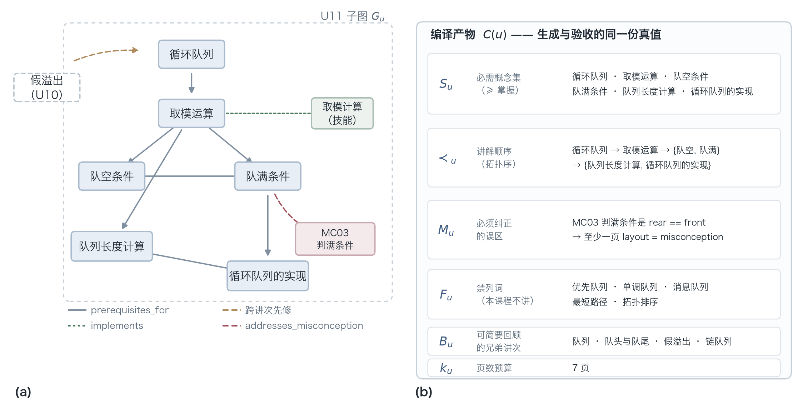
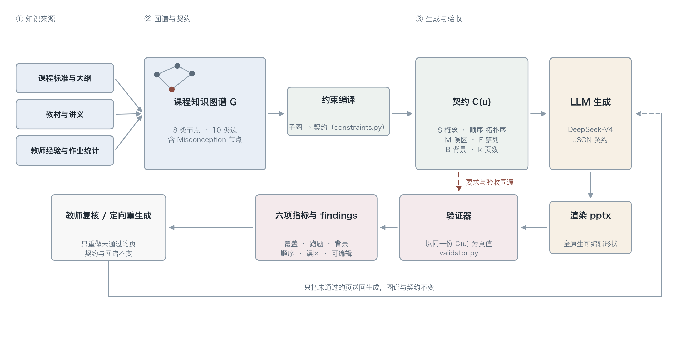

# The Model Knows the Textbook but Not Your Class: Curriculum Knowledge Graph Constraints for Slide Generation in Vocational Education

<!--
Draft v0.1 (EN). Target: Knowledge-Based Systems (Elsevier).
Numbers are transcribed from the executed experiments recorded in results.csv;
see docs/experiment.md for how each figure was produced.
-->

## Highlights

- Course-level knowledge (misconceptions, skill targets, local sequencing) is absent from pretraining data and must be supplied externally.
- We compile a curriculum knowledge graph into a *generation contract* that serves as both prompt source and verification ground truth.
- Coverage rises from 0.61–0.70 to 0.98; a length-matched placebo rules out prompt-length as the explanation.
- Misconception handling reaches 1.000 ± 0.000 against 0.556 ± 0.527 for the same text given without structure.
- Prerequisite-ordering constraints show no reliable benefit; we report this negative result rather than defend it.
- We document seven measurement defects that each silently favour constraint-based methods.

## Abstract

Large language models can now produce a plausible-looking deck of lecture slides in minutes, yet the output rarely survives a teacher's review: a skill explicitly required by the syllabus is missing, the misconception that this year's cohort keeps committing is repeated rather than corrected, or material reserved for a later session is disclosed early. These failures are not defects of generation capability. They arise because the relevant information is absent from the model's parameters: course-level misconception inventories, institution-specific sequencing decisions, and the code-level landing point of a skill have never appeared in pretraining corpora.

We propose modelling such knowledge explicitly as a curriculum knowledge graph and **compiling** it, before generation, into an executable generation contract that is subsequently used, after generation, as the acceptance criterion. The central design decision is *constraint-as-data*: the contract is simultaneously the source of the prompt and the ground truth of the validator, so that what is demanded and what is checked cannot drift apart. We conduct a controlled study on the queue module of a higher-vocational *Python Data Structures* course (3 sessions), covering 6 conditions × 3 resamplings, 3 ablations, and a length-matched placebo arm — 78 independent generations in total.

The results differ from intuition, which is why they are worth recording. Coverage rises from 0.61–0.70 at baseline to 0.98, and the length-matched placebo demonstrates that this is not an artefact of longer prompts. Mean misconception handling rises from 0.56 to 1.00, but the more informative change is in dispersion: the standard deviation falls from 0.53 to 0.00. A condition given the same misconception text without structure succeeds in roughly half of its generations. What the graph changes is therefore not average quality but **reliability**. On prerequisite ordering, by contrast, a strong model already performs well zero-shot, and ablation shows the constraint contributes no reliable gain; we do not defend this negative result. We further document seven measurement defects discovered and corrected during the study, each of which silently favours the constraint-based condition and none of which raises an error — a general trap for text-level automatic metrics in educational generation.

**Keywords**: curriculum knowledge graph; constrained generation; slide automation; misconception modelling; educational knowledge engineering

---

## 1. Introduction

### 1.1 A concrete failure

Asked to write the slides for a session on queues, a general-purpose LLM will typically return a well-organised deck with accurate terminology and runnable code. A teacher skimming it will nod; a teacher reading it closely will frown. The failures look like this:

- The session objective states that students must *implement* enqueue and dequeue on a sequential queue using a Python list. Across the six generated slides, however, the deck never shows **how to actually write it**. It covers the definition, covers the false-overflow problem, and covers the circular queue as the remedy — everything except the step the syllabus requires students to perform.
- The session carries a misconception that more than 60% of this cohort reproduces in the final exam: "a Python `list` is a linked list underneath." The model does not mention it, because it is not a textbook topic but a property of *these* students.
- The model pushes the modular arithmetic of the circular queue into the slide on the sequential queue. Framed as "broadening the view," it in fact violates the prerequisite order: students encounter `% maxsize` before they know what `rear` is.

What these three failures share is that **none of them is a generation-capability problem**. The model is perfectly able to write this content. It simply does not know what *this course* requires, where *this cohort* errs, and how *this institution* sequences its sessions.

### 1.2 Thesis

We argue that the bottleneck in LLM-based slide generation has shifted from *knowledge acquisition* to the **representation and application of course-level knowledge**. A general model possesses disciplinary knowledge (what a queue is, why FIFO matters). Slide production requires *situated* knowledge: this course, this cohort, this schedule.

Situated knowledge has three properties, each of which happens to be a blind spot of current LLMs:

| Property | Example | Why the model cannot learn it |
| --- | --- | --- |
| **Cohort-specific** | This year's students confuse *empty* and *full* conditions at a rate above 60% | Exists only in teacher experience and assignment statistics, in no public corpus |
| **Institution-specific** | Our department merges "linked queue" and "introducing BFS" into one session | A teaching-office scheduling decision that varies by institution |
| **Landing-point specific** | This course requires "can write the code," not merely "can state the concept" | Set by the curriculum standard, not by the textbook |

None of these can be obtained through a larger model or a better prompt; they must be **supplied from outside**. The question then becomes: in what form should they be supplied, such that the model can follow them *and* the system can afterwards check whether it did?

### 1.3 Our answer

A **knowledge graph**. The justification is not fashion but the fact that it satisfies four requirements at once:

1. **Expressiveness.** Misconceptions, skills, prerequisite relations, and competence levels are heterogeneous entities; a graph accommodates them naturally.
2. **Orderability.** `prerequisites_for` is a directed edge, so a topological sort directly yields a legal teaching order.
3. **Compilability.** The subgraph of one session can be mechanically compiled into a generation contract (concept inventory, order, misconceptions, forbidden terms).
4. **Reusability as ground truth.** The same contract can be used to validate the output — **what is demanded and what is checked share one source, and cannot drift**.

Point 4 is the essential difference from "writing the key points into the prompt." A prompt is discarded once written, and there is no way afterwards to determine whether the model complied. A contract is a data object, readable by programs both before and after generation.

### 1.4 Contributions

1. **A curriculum-graph schema for vocational programming courses.** We extend the seven node types of K12-KGraph [9] by promoting `Misconception` to a first-class node, and add two edge types: `implements` (concept → executable code) and `addresses_misconception` (teaching unit → misconception). The former makes "can write it" a checkable property; the latter makes corrective content a constrainable generation target.
2. **A constraint-as-data generation framework.** `UnitConstraints` drives both prompt construction and post-hoc validation; topological order, required/optional partitioning, sibling-session background caps, and forbidden-term lists are all derived mechanically from the subgraph, with no hand-written rules.
3. **A reproducible six-metric acceptance protocol**, two of whose metrics are redefined for this task: prerequisite order is judged by **where a concept is named in a slide title** (not by model-reported IDs), and coverage is matched against **graph synonyms** (so that a condition copying the source wording gains no advantage).
4. **An honest empirical study.** 6 conditions × 3 sessions × 3 resamplings, plus 3 ablations and a length-matched placebo: 78 independent generations. We report gains *and* the absence of gain: misconception handling differs decisively in both mean and variance; coverage improves by about 0.3 with the length explanation excluded by the placebo; and ordering constraints show no reliable contribution under a strong model. We also document **seven** measurement defects that systematically favour constraint-based methods, together with their fixes (§7.1).

### 1.5 Why this belongs in Knowledge-Based Systems

The object of this paper is not "a better slide generator" but **how knowledge must be represented in order to be actionable by a machine**: what structure suffices to constrain generation, how it is compiled, how it is verified, and along which dimensions a knowledge base is genuinely irreplaceable. This matches the knowledge-representation / reasoning / system-evaluation loop that KBS serves.

Three recent KBS lines form the immediate context. Dai et al. [1] systematically compare how LLMs comprehend knowledge graphs presented in different prompt formats (linearised triples, fluent natural language, neighbourhood expansion), showing that **the presentation format itself changes performance**; Huang et al. [2] find that graph-triple prompting generally outperforms passage prompting on long-tail factual question answering, and that combining them markedly reduces hallucination, showing that **structure and text are not interchangeable**; Ma et al. [3] apply knowledge-enhanced LLMs to course recommendation, placing education among the journal's active application areas. We continue this line but move the question from *how to put knowledge in* to *whether the knowledge once inserted can also serve as the acceptance criterion*.

We emphasise **negative results**: a knowledge graph is not superior to a strong model along every dimension, and identifying *which* knowledge must be externalised is more valuable than a blanket claim that knowledge augmentation works.

---

## 2. Related work

### 2.1 Automatic slide generation

Three strands can be distinguished, each solving a different problem.

**(a) Document-to-slide: fidelity to the input.** DOC2PPT [4] first formalised the task, observing that it simultaneously demands document summarisation, figure-text retrieval, and layout arrangement. It proposed a hierarchical sequence-to-sequence model and released 5,873 paired document–slide examples drawn from CV, ACL and ICML proceedings, together with four metrics (slide-level ROUGE, LC-FS, TFR, mIoU). Mondal et al. [5] introduced *end-user specifications*: the same paper should yield different decks for different audiences or durations. They built four persona configurations on SciDuet, fine-tuned an LLM on target-audience feedback, and cut preparation time from about one hour to under thirty minutes. Notably, the authors state in their limitations that they **do not address slide layout design** — the contribution is content and logical alignment only.

**(b) Instruction-to-slide: fidelity to editability.** AutoPresent [6] released SlidesBench (7k training / 585 test examples from 310 real decks across 10 domains) and compared end-to-end image generation against program generation, concluding that **programmatic generation yields higher-quality slides** because the artefacts are interactive and re-editable; an 8B model trained on the benchmark matches GPT-4o. PPTAgent [8] adopts a two-stage edit-based approach: analyse reference decks to extract slide-level functional types and content schemas, then draft an outline and iteratively generate editing actions, with PPTEval assessing content, design and coherence. Our rendering decisions (native shapes, a mandatory JSON intermediate representation) follow this strand's conclusions.

**(c) Evaluation: from "does it look right" to "is it done".** PPTC [7] changes the question from whether slides look good to whether a model can modify a deck correctly under multi-turn instructions. Its 279 multi-turn sessions come with PPTX-Match, which compares the resulting `.pptx` file state rather than the API sequence and therefore admits multiple valid solutions. GPT-4 reaches 75.1% single-turn accuracy but only 6% session accuracy, with errors traced to multi-turn accumulation, long template processing, and multimodal perception.

**Our difference.** The inputs to the above work are a **document to be compressed** or **a single instruction**; the criteria are resemblance to the source, visual appeal, or task completion. Our input is a **course specification** (what to teach, in what order, which misconception to correct, what not to introduce), and the criterion is conformance to the syllabus. This is not a relabelling: neither the reference-based nor the reference-free protocol of SlidesBench can express "the deck omits the skill the syllabus requires students to implement," which is precisely the most damaging class of failure in a teaching context.

### 2.2 Educational knowledge graphs

K12-KGraph [9] is the closest knowledge-side work. Extracted from the official People's Education Press textbooks, it defines seven node types (Book, Chapter, Section, Concept, Skill, Experiment, Exercise) and nine relation types (`is_a`, `prerequisites_for`, `relates_to`, `verifies`, `tests_concept`, `tests_skill`, `appears_in`, `leads_to`, `is_part_of`), covers 48 volumes across mathematics, physics, chemistry and biology, and yields 10,685 nodes and 23,278 edges. From it the authors derive K12-Bench (23,640 multiple-choice items in five task families: Ground, Prereq, Neighbor, Evidence, Locate) and K12-Train (a graph-guided SFT corpus). Its most telling number is not the overall score but the fact that **even the strongest proprietary model leaves more than 40% of Prereq and Neighbor items unsolved** — evidence that structural curriculum cognition is a capability dimension independent of factual recall, and precisely the dimension we attempt to supply externally.

SciMKG [10] moves to multimodality: an LLM-driven extraction–verification–integration–augmentation pipeline builds a graph over text, images, video and audio from open courseware, yielding 1,356 knowledge points, 34,630 multimodal concepts and 403,400 triples, with concept-extraction F1 improved by 9% over baselines. On the application side, Ma et al. [3] apply knowledge-enhanced LLMs to course recommendation, confirming sustained interest in the knowledge-structure × education combination.

The centre of gravity in this literature is **building** graphs (extracting entities and relations from corpora, ensuring consistency). Ours is **using** them (compiling a graph into generation constraints and validating against it). The two are complementary: our method can consume graphs produced by the above work directly, and indeed we reuse the K12-KGraph node and relation skeleton, adding to it rather than replacing it (§4.1).

In vocational education, a graph must additionally express two things that general subject-matter graphs do not emphasise: **competence level** (understand / comprehend / master / proficient, which decides whether a concept is mandatory or optional) and **typical misconceptions** (which decide corrective content). K12-KGraph carries an `importance` attribute on concepts but does not use it to constrain generation; misconceptions are absent entirely. This is the direct motivation for our schema extension.

### 2.3 Constrained generation

Classical NLG separates *what to say and in what order* (content planning) from *how to say it* (surface realisation) [11]. Wiseman et al. [12] showed on RotoWire that end-to-end models produce fluent game reports while systematically erring on content selection and discourse order, in some metrics even being surpassed by template baselines. Puduppully et al. [13] therefore model content planning explicitly: first predict which records to mention and in what order, then generate conditioned on that plan. What unites this line is that structure is injected into the **training objective or the decoding process**.

In the LLM era, structure is injected through prompts instead, and the question becomes *in what form*. Dai et al. [1] provide the most systematic evidence to date: the same graph, presented as linearised triples, fluent paragraphs, or expanded neighbourhoods, is comprehended with markedly different effectiveness, and the difference is explicable from attention distributions. Huang et al. [2] offer a complementary result on long-tail factual QA: triple-based prompting generally beats passage-based prompting, and combining both does not always improve coverage but does markedly reduce hallucination. In short, **structured knowledge is not simply "text written differently."**

We differ from both lines deliberately: we neither train, nor modify decoding, nor rerank. We compile constraints into an **executable data object**, use it to construct the prompt before generation, and use the same object to validate afterwards. Relative to [1,2], the question advances from "how should a graph enter the prompt" to "can one graph simultaneously serve as the acceptance criterion" — if so, demand and check cannot drift (§1.3). The price is that we relinquish control over decoding and must bear the risk that the model disobeys; §5.6 reports a real violation and §7.1 reports seven metric traps that this permissiveness exposed.

---

## 3. Problem formulation

### 3.1 Curriculum knowledge graph

Define a curriculum knowledge graph as a typed directed heterogeneous graph $G=(V,E,\tau)$, where

- $\tau: V \to T_V$ with $T_V=\{\text{Course},\text{Module},\text{Unit},\text{Concept},\text{Skill},\text{Lab},\text{Exercise},\text{Misconception}\}$;
- each edge $e=(u,r,v)\in E$ carries a relation type $r\in T_E$ with
  $T_E=\{\text{is\_a},\text{prerequisites\_for},\text{relates\_to},\text{implements},\text{verified\_by},\text{assessed\_by},\text{addresses\_misconception},\text{appears\_in},\text{is\_part\_of},\text{leads\_to}\}$;
- selected edges carry an `evidence` field recording the provenance of the relation (textbook page, curriculum-standard clause, error-rate statistic).

**Constraint 1 (acyclicity).** The subgraph induced by `prerequisites_for` must be a DAG. We detect violations with Kahn's algorithm: if the concept set of a session cannot be topologically ordered, the course design itself contains a circular prerequisite, and construction fails immediately rather than deferring the contradiction to generation time.

### 3.2 Session contract

For a session $u\in V$ with $\tau(u)=\text{Unit}$, take the subgraph

$$G_u = \{v \in V : (v,\text{appears\_in},u)\in E\}$$

and compile it into a contract

$$C(u)=\langle S_u,\ \prec_u,\ M_u,\ F_u,\ B_u,\ k_u\rangle$$

| Symbol | Meaning | Source |
| --- | --- | --- |
| $S_u=(R_u,O_u)$ | required / optional concept sets | split on `importance`; ≥ "master" is required |
| $\prec_u$ | teaching order (a total order on $S_u$) | topological order of `prerequisites_for` over $G_u$ |
| $M_u$ | misconceptions that must be corrected | `Misconception` nodes targeted by `addresses_misconception` |
| $F_u$ | forbidden-term list | `forbidden_terms` on the Unit node |
| $B_u$ | sibling-session concepts admissible as brief recap | concepts of other Units in the same Module, deduplicated |
| $k_u$ | slide budget | `slide_budget` on the Unit node |

**A critical distinction** separates $B_u$ from $F_u$. The former means "already covered, may be mentioned in one sentence"; the latter means "not taught in this course at all." Conflating them makes two metrics fight each other (the same term counts both as legitimate recap and as out-of-scope), so the implementation enforces mutual exclusivity by assertion.

**Compilation is mechanical and lossless.** Figure 2 shows the actual U11 subgraph and the contract compiled from it: every edge in (a) maps to a field in (b), and nothing in (b) is hand-written.



**Figure 2. From subgraph to contract.** (a) The actual U11 subgraph in `data/kg_pyds_m4.json`: six concepts and one skill, seven intra-session prerequisite edges, one cross-session prerequisite edge from U10, one `implements` edge and one `addresses_misconception` edge. (b) The contract $C(u)$ produced from it by `build_constraints`; the validator subsequently reads the same object.

### 3.3 Generation and acceptance

Generation is a mapping $D = f_\theta(C(u))$ where $D$ is a sequence of slides. Acceptance is a metric vector

$$m(D, C(u), G) = \langle \text{cov},\ \text{oog},\ \text{bg},\ \text{pre},\ \text{mc},\ \text{edit}\rangle$$

defined in §5.3. Note that $C(u)$ appears on both sides: this is the formal statement of "demand and check share one source."

The full pipeline is shown in Figure 1: graph → contract compilation → generation → rendering → validation against the same contract. One loop exists: pages that fail validation are sent back for regeneration. Its boundary is deliberately fixed — **the loop may change slides, but never the graph and never the contract** — and whether to regenerate is a teacher's decision, not an automatic optimisation. Were validation output allowed to reshape the contract, acceptance would degrade into an objective and the metrics would lose their meaning (§7.1).



**Figure 1. Framework overview.** The contract $C(u)$ is read once before generation (to build the prompt) and once after (to compute the six metrics); both reads concern the same object — which is what "demand and check share one source" means in implementation terms.

---

## 4. Method

### 4.1 Graph construction

#### 4.1.1 Nodes and edges

We retain the seven node types of K12-KGraph [9] (`Lab` corresponds to its `Experiment`) and promote `Misconception` to an eighth:

```yaml
Misconception:
  attributes:
    statement:   # the erroneous claim itself; must be concrete and decidable
    correction:  # the correct understanding
    frequency:   # low / common / high
    evidence:    # source: exam error rate, assignment statistics, in-class questioning
```

Two edge types are added:

- `implements`: Concept/Skill → executable code fragment. It makes "can write it" a checkable property and supplies the generator with runnable examples;
- `addresses_misconception`: Unit/Concept → Misconception, annotated with a `strategy` (counter-example / code demonstration / boundary test). This edge decides **which session is responsible** for correcting a given misconception, preventing both duplication across sessions and orphaned misconceptions.

#### 4.1.2 Synonyms (aliases)

Every concept may carry `aliases`. This is not a patch for evaluation but legitimate graph content: in class the teacher says "judging full," the textbook writes "the full condition," and the code reads `(rear+1) % maxsize == front`; all three denote one entity. Without aliases the graph cannot be aligned with real teaching language.

**Aliases also resolve a fairness problem in evaluation** — see §7.1, defect 1.

### 4.2 Constraint compilation

`build_constraints(G, u)` turns the subgraph into `UnitConstraints` with no hand-written rules:

1. **Required/optional split.** Sort by `importance`; those at or above "master" enter $R_u$, the rest $O_u$.
2. **Topological order.** Run Kahn's algorithm over $S_u$; on encountering a cycle, fall back to declaration order and raise a warning.
3. **Misconception assignment.** Take incoming `addresses_misconception` edges.
4. **Sibling sessions.** Concept names of other Units in the same Module, minus those already in this session.
5. **Evidence anchors.** Collect `evidence` along incoming `prerequisites_for` / `implements` / `verified_by` edges and render them as **teacher-facing** verification material, explicitly labelled "not generated content" so that the model does not copy the provenance into the slides as body text.

The compilation output is a **deterministic string**: the same graph always yields the same prompt block, which is a precondition for reproducibility.

### 4.3 Generation

The prompt is assembled from four segments — a fixed skeleton, the contract block, a JSON contract, and a list of hard rules — and the experimental conditions of §5.2 replace only some of them.

Output is constrained to a single JSON object, each slide carrying `layout` (one of seven), `title`, `bullets`, `code`, `notes`, `concept_ids`, and `background`. Forcing JSON rather than free-form layout is a deliberate choice: layout selection is itself an instructional-design decision, and delegating it to the model makes both editability and slide budget uncontrollable.

**Two engineering realities, both observed rather than assumed:**

1. **JSON mode is not a validity guarantee.** Roughly once every ten calls the response contains a trailing comma (`..., ]`), or returns blank while reporting `finish_reason == "stop"` (the offending fragment replaced by whitespace). The pipeline therefore implements *call → conservative repair (strip trailing commas, close truncated brackets) → parse*, and only escalates by re-prompting with the concrete parse error when repair fails. Blind retries reproduce the same error at the same cost.
2. **The model performs internal reasoning by default.** Every call in our setup produced `reasoning_tokens`, which contaminates a chain-of-thought baseline (the model is already doing CoT). We record the setting explicitly and provide a switch to disable it for a robustness check.

### 4.4 Rendering

`python-pptx` emits 16:9 fully native shapes with no rasterised text. `editability` is defined as the ratio of native editable shapes to all shapes; it is 1.0 for every condition here. This dimension does not discriminate between methods; it exists to exclude "screenshot-style generation," whose value for a teacher who needs to edit is zero.

For Chinese text, the `a:ea` and `a:cs` typeface attributes must be set explicitly, otherwise PowerPoint falls back to a Latin font and glyphs are corrupted.

### 4.5 Validation

The six metrics are defined in §5.3. Three implementation choices are deliberate:

- **Chinese has no word boundaries.** `队列` (queue) matches inside `循环队列` (circular queue). All counting therefore uses per-line net occurrences: raw count minus occurrences covered by longer terms **within the same line**. Subtracting over the whole document rather than per line is a real bug: an independent `队列` on slide 2 is otherwise cancelled by `顺序队列` on slide 4.
- **Triple-criterion misconception detection.** Structural anchor (does the misconception slide reference a graph-linked concept) → English-identifier overlap (`rear`, `list`) → Chinese character bigram overlap (threshold 0.35). Purely lexical matching misses cases where the model paraphrases the erroneous claim in its own words — we observed a generated correction slide rejected because its phrasing differed from the graph's.
- **Order by first textual position**, see §5.3.

---

## 5. Experiments

### 5.1 Course and data

- **Course**: *Python Data Structures*, higher-vocational programme in Artificial Intelligence Technology Application, 136 contact hours.
- **Graph scope**: Module M4 "Queues", 3 sessions (U10 concepts and false overflow; U11 circular queue; U12 linked queue and introducing BFS), 33+ nodes, 70+ edges, 4 misconceptions.
- **Rationale for this module**: the prerequisite chain is clean (queue → sequential queue → circular queue → linked queue), whereas deep-learning courses have mutually referencing concepts that easily form cycles and are therefore unsuitable as a first validation scenario.

**Why only three sessions.** The goal is to establish *whether and along which dimensions* graph constraints help, not to maximise a course-wide number. Three sessions cover three qualitatively different cases: concept-dense (U11 has seven required concepts), skill-landing (U10 contains a skill that must be implemented by hand), and application-introduction (U12 requires a comparative selection against prior material).

### 5.2 Conditions

**Six conditions** with strictly increasing information, each step removing one structural element:

| Condition | Course/session | Page budget | Concept names + definitions | Topological order | Misconceptions | Forbidden terms | Prompt length (U11) |
| --- | :-: | :-: | :-: | :-: | :-: | :-: | :-: |
| `full` (ours) | ✓ | ✓ | ✓ | ✓ | ✓ (own block + layout requirement) | ✓ | 1997 |
| `rag_mc` | ✓ | ✓ | ✓ | ✗ | ✓ (flat text) | ✗ | 1122 |
| `rag` | ✓ | ✓ | ✓ | ✗ | ✗ | ✗ | 997 |
| `placebo` | ✓ | ✓ | ✗ | ✗ | ✗ | ✗ | 2195 |
| `cot` | ✓ | ✓ | ✗ | ✗ | ✗ | ✗ | 625 |
| `zero_shot` | ✓ | ✓ | ✗ | ✗ | ✗ | ✗ | 585 |

- `rag` − `zero_shot` measures the contribution of **content retrieval**;
- `full` − `rag` measures the contribution of **structural constraints**;
- `rag_mc` is a control built specifically for the misconception claim: the same misconception text is supplied as a flat passage, but without ordering and without layout requirements. If `full` still wins on the misconception metric, the gain comes from *structuring the text to the point where it constrains layout*, not from *the text appearing in the prompt*;
- `placebo` is a control built specifically for the alternative explanation "the prompt is simply longer": the prompt is **length-matched** to `full` (in fact slightly longer), but padded with generic slide-writing advice unrelated to this course. If the advantage of `full` were prompt length, the placebo should catch up. It does not (§5.4).

**Three ablations** retain `full`'s complete contract and rule wording, deleting exactly one data block:

| Condition | Removed | Rule removed in step | Expected metric |
| --- | --- | --- | --- |
| `no_order` | order block | rule 3 | `prerequisite_violation` |
| `no_misconception` | misconception block | rule 5 | `misconception_coverage` |
| `no_forbidden` | forbidden-term block | rule 6 | `oog_rate` |

The rule text must be removed together with the data. Deleting only the data while keeping "you must follow the given order" forces the model to guess an order, and the ablation is no longer clean. The test `test_ablation_prompt_drops_exactly_one_block` guards this.

### 5.3 Metric definitions

| Metric | Definition | Direction |
| --- | --- | --- |
| `coverage_rate` | fraction of required concepts actually taught | ↑ |
| `oog_rate` | (out-of-graph IDs + forbidden-term hits) / (covered + out-of-graph) | ↓ |
| `background_rate` | characters devoted to sibling-session concepts / total characters (cap 25%) | ↓ |
| `prerequisite_violation` | violated concept pairs / all concept pairs | ↓ |
| `misconception_coverage` | misconceptions corrected / misconceptions linked to the session | ↑ |
| `editability` | native editable shapes / all shapes | ↑ |

Three definitional decisions determine the conclusions and therefore require explicit justification:

1. **Coverage counts body slides only.** Title, objectives and summary slides list every concept by definition; counting them as "taught" lets a deck consisting of a table of contents score full marks.
2. **Coverage matches on name ∪ aliases.** Otherwise the `full` condition, which copies source names, enjoys a structural advantage (§7.1, defect 1).
3. **Order is judged by first textual position.** The model's `concept_ids` are self-reported, and the three baselines were never told the field exists. Scoring on self-reports means a completely empty answer receives a zero violation rate.

### 5.4 Results

Each condition runs 3 sessions × 3 resamplings = 9 independent generations; each ablation runs 6. Values are mean (standard deviation).

**Table 1. Main results** (n = 9)

| Condition | Coverage ↑ | Out-of-graph ↓ | Background ↓ | Order viol. ↓ | Misconception ↑ | Editability ↑ | Pass rate | Output tok |
| --- | :-: | :-: | :-: | :-: | :-: | :-: | :-: | :-: |
| **full (ours)** | **0.981** (0.056) | **0.000** | 0.027 (0.016) | **0.020** (0.045) | **1.000** (0.000) | 1.000 | 67% | 4079 |
| rag_mc | 0.698 (0.295) | 0.111 (0.220) | 0.027 (0.016) | 0.007 (0.022) | 0.556 (0.527) | 1.000 | 22% | 2689 |
| rag | 0.659 (0.248) | 0.111 (0.220) | 0.032 (0.014) | 0.030 (0.089) | 0.222 (0.441) | 1.000 | 0% | 2378 |
| placebo (length-matched) | 0.675 (0.266) | 0.167 (0.250) | 0.040 (0.018) | 0.096 (0.131) | 0.333 (0.500) | 1.000 | 0% | 1444 |
| cot | 0.614 (0.185) | 0.019 (0.056) | 0.040 (0.016) | 0.089 (0.183) | 0.389 (0.486) | 1.000 | 0% | 2638 |
| zero_shot | 0.643 (0.248) | 0.019 (0.056) | 0.040 (0.011) | 0.037 (0.089) | 0.222 (0.441) | 1.000 | 0% | 2330 |

Four observations, ordered by importance.

**(1) Coverage: 0.981 against 0.61–0.70, and not an effect of prompt length.** The five controls lie within 0.09 of one another (0.614–0.698) while all have large dispersion (0.19–0.30); `full` is about 0.3 higher with dispersion down to 0.056. The decisive evidence is the placebo: its prompt is comparable in length to `full` (2195 vs. 1997 characters on U11, in fact longer), but its content is generic writing advice unrelated to the course, and its coverage is 0.675 — indistinguishable from zero-shot. The coverage gain therefore comes from **course structure**, not from saying more.

**(2) Misconception: the mean is the lesser finding; the disappearance of variance is the greater.** This is the strongest evidence in the paper. `rag_mc` gives the model the same misconception text and reaches a mean of 0.556, but with a standard deviation of 0.527 — it succeeds reliably in only about half of nine generations. `full` reaches 1.000 with zero dispersion. In other words, **telling the model the knowledge yields a system that depends on luck; structuring the knowledge into a layout requirement yields a reliable system.** This is precisely our thesis: the value of the graph is not that it conveys content but that it forces content to appear *at a specific position*.

**(3) Ordering: the constraint helps but not significantly, and adds no reliable marginal contribution.** `full`'s violation rate of 0.020 is below the placebo's 0.096 and cot's 0.089, but `zero_shot` sits at 0.037 — a condition given no ordering information at all is nearly as good. This is consistent with the ablation below and with the explanation that strong models already have a sound intuition for textbook prerequisite chains. We do not defend it: **on this task, ordering is not where the knowledge graph earns its keep.**

**(4) Out-of-graph: `rag` and `rag_mc` are worse than zero-shot.** Both reach an `oog_rate` of 0.111 and the placebo 0.167, whereas `zero_shot` sits at 0.019 and `full` at 0. Telling the model "this session covers these points" leads it to bring in adjacent advanced material (mentioning priority queues in a session on queues), because the prompt demarcates a scope without demarcating a boundary. `full` reaches zero only by virtue of the **forbidden-term list** — an explicit negative example — as the ablation confirms.

**Table 2. Ablations** (each removes exactly one part of the graph; n = 6)

| Condition | Coverage ↑ | Out-of-graph ↓ | Order viol. ↓ | Misconception ↑ |
| --- | :-: | :-: | :-: | :-: |
| full | 1.000 (0.000) | 0.000 (0.000) | 0.032 (0.078) | 1.000 (0.000) |
| − ordering | 1.000 (0.000) | 0.000 (0.000) | 0.000 (0.000) | 1.000 (0.000) |
| − misconceptions | 0.944 (0.086) | 0.000 (0.000) | 0.040 (0.064) | **0.167** (0.408) |
| − forbidden terms | 1.000 (0.000) | **0.083** (0.129) | 0.000 (0.000) | 1.000 (0.000) |

The ablation yields two positives and one negative, cleanly separated:

- Removing the misconception block drops misconception coverage from 1.000 to 0.167 and coverage from 1.000 to 0.944 — the block carries corrective content and incidentally helps the model organise the session's key points.
- Removing the forbidden-term list raises the out-of-graph rate from 0.000 to 0.083 with every other metric unchanged — single responsibility, clean attribution.
- Removing the ordering constraint drops the violation rate from 0.032 to **0.000**, opposite to expectation. This is not a measurement error: `full`'s 0.032 traces to one genuine inversion in U10 (sequential queue taught before head and tail). At the scale of 7 concepts and 21 concept pairs, a single inversion is of order 0.05, so the difference lies entirely within noise. **We conclude that the ordering constraint has no reliable effect on this data.**

### 5.5 Cost and latency

| Condition | Input tok | Output tok | of which reasoning | Latency (s) |
| --- | :-: | :-: | :-: | :-: |
| full | 1064 | 4079 | 2708 | 20.8 |
| rag_mc | 618 | 2689 | 1441 | 14.4 |
| rag | 536 | 2378 | 1133 | 12.3 |
| cot | 373 | 2638 | 1157 | 14.4 |
| zero_shot | 347 | 2330 | 984 | 12.4 |

`full` emits about 1.75× the output tokens of `zero_shot`, with end-to-end latency of 20.8 s against 12.4 s. The surplus comprises the contract block itself (about 500 input tokens) and longer slide content with more reasoning tokens. Per deck the cost remains in the "cents" range, negligible against teacher preparation time; for course-wide batch generation, however, the 1.75× gap is worth engineering away (for example by caching contract blocks per session).

Note that `full`'s longer output is not due to more slides — the page count is fixed by `slide_budget` and met in every run (`page_budget_ratio` = 1.0) — but to fuller `notes` on each slide. This is a benefit for teachers, since speaker notes are the bulk of lesson preparation.

### 5.6 Qualitative observations

**A positive case: `full` on U12.** U12 is the hardest of the three sessions: it requires students to *choose* between a circular and a linked queue, a judgement task with no single correct answer, and one of its required concepts ("application scenarios of queues") is abstract and easily reduced to platitudes. All three `full` runs reached coverage 1.000 and each produced a genuine comparison slide (predictable capacity / frequent queries → circular queue; highly variable length / frequent enqueue-dequeue → linked queue), handling the BFS misconception on a dedicated counter-example slide. Coverage for the five baselines on the same session is **0.333**: they cover only "linked queue" and dispose of selection and scenarios in a single clause.

**A negative case: `full` fails too.** In the third resampling of U10, coverage is 0.833, missing the concept "queue" itself. Reading slide by slide: the title slide states "a queue is a linear list inserting at one end and deleting at the other," but the first body slide is titled "head, tail and the sequential queue," and the deck never defines a queue separately again. This is not a metric artefact — the definition genuinely stayed on the title slide, with the model assuming students would remember it. The validator flagged it as `MISSING_CONCEPT`, which is exactly the point of closing the loop: the method does not guarantee correctness, it guarantees that **errors are not silently passed over**.

A second failure is more instructive still: the second resampling of U10 contains two prerequisite inversions, the model teaching "sequential queue" first and returning to "head and tail" afterwards. On the metrics this is a 0.133 violation rate; in the classroom it means students first encounter `front` and `rear` without knowing what they denote. The topological order was in the prompt and the model violated it anyway — which is why we insist on post-hoc validation rather than assuming that saying it implies doing it.

---

## 6. Discussion

### 6.1 Where the graph helps and where it does not

Rearranging the six metrics by "does the graph make an irreplaceable contribution" gives a clear picture:

| Dimension | Verdict | Evidence |
| --- | --- | --- |
| **Misconception handling** | Irreplaceable | `full` 1.000±0.000 vs. `rag_mc` 0.556±0.527 with the same text |
| **Coverage completeness** | Irreplaceable | 0.981 vs. 0.61–0.70; length-matched placebo excludes prompt length |
| **Scope control** | Partial | Rests on the forbidden-term list as an explicit negative example; ablation confirms (0.000 → 0.083) |
| **Prerequisite order** | **No reliable contribution** | `full` 0.020 vs. `zero_shot` 0.037; ablation runs in the opposite direction |
| **Editability** | Orthogonal | 1.000 everywhere; determined by the renderer |

This ordering is itself a result: **the graph supplies not disciplinary knowledge but the layer of institutional convention around it.** Disciplinary knowledge — what a queue is, why FIFO matters, what to teach first — is already handled well enough by a strong model, so the marginal value of the graph along the ordering dimension is close to zero. Conversely, which concepts count as "must be finished in this session," where this cohort errs, and what belongs to the next session appear in no pretraining corpus; once the graph supplies them, the model uses them, and uses them stably.

### 6.2 Three kinds of knowledge that must be externalised

Returning to the taxonomy of §1.2, the experiments assign each a strength of evidence.

**(1) Cohort-specific misconceptions — strongest evidence.** This is the only dimension where "given the text, still unstable; given the structure, stable" holds. `rag_mc`'s half-success rate shows that, having seen the misconception, the model writes a correction slide in about half the cases and folds it into a bullet elsewhere in the other half, after which it disappears. `full` converts it into a hard constraint through a layout-level requirement ("at least one slide with `layout == misconception`"). **The conclusion: misconception knowledge must not only be stated, it must be stated into position.**

**(2) Skill landing points from the syllabus — clear evidence.** Baselines systematically omit skills such as "can implement enqueue and dequeue on a sequential queue using a list." Not because the model cannot write code, but because it does not know that this session requires *writing* rather than merely *understanding*. Competence level is fixed by the curriculum standard and cannot be inferred. The 0.98 vs. 0.67 coverage gap comes largely from here — on U12, 0.333 vs. 1.000.

**(3) Institution-specific prerequisite conventions — insufficient evidence.** We expected this to be a key selling point; it does not hold empirically. Strong models already have a stable intuition for textbook prerequisite chains (queue → sequential queue → circular queue), and this course's order within the module matches the standard textbook, leaving no discriminating power. Testing this claim requires a test set built on a syllabus that **deliberately departs** from the standard order. This is the most worthwhile follow-up.

### 6.3 A measurement lesson worth remembering

Perhaps the most valuable sentence in this paper is not "coverage improved by 0.3" but:

> On the misconception dimension, `rag_mc`'s mean differs from `full`'s by only 0.44, while its standard deviation differs by 0.53. What the graph changes is not **average quality** but the **reliability of quality**.

When a generative system enters a teaching workflow, what teachers care about is rarely "how good can it get" but "how bad can it get," because a class happens on schedule and one failure means redoing the work. By that standard, a 0.556±0.527 system is unusable and a 1.000±0.000 system is usable. This also suggests that evaluation in this area should report **variance**, not only means; in the comparable literature we surveyed, variance is frequently absent.

### 6.4 The value of negative results

If a knowledge-augmentation method wins on every metric, the usual explanation is that the baseline was weakened. That we report no gain from ordering, no discrimination from `editability`, and a 33% non-pass rate for `full` itself is a credibility signal: the metrics do not systematically favour the constraint-based condition (we fixed seven defects to that end, §7.1), and the value of the knowledge base is concentrated in a narrow but critical gap.

For KBS readers this gap is worth noting: it cannot be closed by a better generator, because it is not a capability problem but a problem of information provenance.

---

## 7. Threats to validity

### 7.1 Text-level metrics systematically favour constraint-based methods

This is the most important methodological caution in the paper. During the study we discovered and corrected **seven** measurement defects. Each made the `full` condition win without cause, and not one raised an error — the metrics kept emitting plausible numbers that happened to be wrong. None was found by reflection; all came from printing model outputs slide by slide and reading them.

| # | Defect | Symptom | Consequence | Fix |
| :-: | --- | --- | --- | --- |
| 1 | Verbatim coverage matching | Graph says "enqueue and dequeue operations," baseline writes "enqueue and dequeue" | Baseline coverage crushed to 0.50 while `full` scores 1.00 by copying source wording | Add `aliases` to the graph; one shared vocabulary across conditions |
| 2 | Order scored from self-reported IDs | Baselines never fill `concept_ids` | Empty sequence → 0.00 violation, **an unanswered script scores full marks** | Score from textual position instead |
| 3 | Preview slides counted as body | Title and objectives slides list every concept | Ordering determined by list order rather than teaching order; 3 spurious violations in U10 | Exclude title / objectives / summary |
| 4 | Forward reference treated as teaching | One slide remarks "modular arithmetic is key to implementing the circular queue" | The concept is located three slides early; 2 spurious violations in U11 | Locate by title naming first, fall back to first mention |
| 5 | Cross-slide subtraction | `队列` cancelled by `顺序队列` on another slide | Concept judged "never taught"; coverage falsely reported as 0.83 in U10 | Compute net occurrences **per line** |
| 6 | Misconception anchors too broad | Unit-level `addresses_misconception` used as a slide anchor | Any slide with the same layout counts as corrected; the ablation still scores 1.00 | Restrict anchors to concept level; fix one mis-attached data edge |
| 7 | Out-of-graph test too strict | Baselines invent their own ID scheme (`queue-def`) | Out-of-graph rate inflated to 0.67 when the only difference is a namespace | Count only non-existent IDs matching the graph's ID format |

The common structure across all seven: **the representation the constrained method receives is exactly the representation the metric uses.** Any metric that scores against the list in the prompt encounters this problem.

Defect 6 deserves separate mention, because it is not a bug in the metric code but **an error in the graph data**. We attached an edge from the misconception "a stack also yields the same level order for BFS" to a concept about empty-queue detection in the linked queue, on the reasoning that they were "related." They are not, instructionally. The consequence was that any misconception-layout slide referencing empty-queue detection counted as having addressed the BFS misconception, so the ablation still scored full marks and the entire "misconception injection works" conclusion nearly became false. **Graph errors silently contaminate metrics** — a risk specific to knowledge-graph-driven methods, which purely prompt-based methods do not face.

We therefore recommend that work of this kind report two things: (a) how the metrics behave **on the baselines**, not only the final numbers; and (b) at least one manual pass in which outputs are printed slide by slide, rather than reading only the summary table.

### 7.2 Sample and external validity

Three sessions, one course, one model, two to three resamplings per cell. Statistically this supports descriptive reporting only; it does not license significance claims. Generalisation across courses (especially non-programming ones) and across models (including open-weight ones) is untested.

### 7.3 No human grading

The six metrics measure **conformance to the contract**, not teaching quality. Whether examples are apt, pacing sensible, or board work clear is entirely beyond them. Blind teacher evaluation is a necessary complement and is not yet complete.

### 7.4 The constructedness of the misconception result

`misconception_coverage` is structurally unfavourable to baselines, since they were never told about the misconceptions. Our response is the `rag_mc` control, which supplies the same text in flat form. If `full` still wins, the gain comes from structure rather than information. Even so, we must concede that **the metric measures whether the course-required correction was made, not whether it is correct**.

---

## 8. Conclusion and future work

We reframe slide generation as a **course-specification satisfaction problem**, carry situated knowledge in a knowledge graph, and use constraint-as-data so that one contract serves simultaneously as generation basis and acceptance ground truth. Empirically, a strong model is already good enough at prerequisite ordering; what the graph makes irreplaceable are **the skill landing points in the syllabus** and **the cohort-specific misconceptions**, neither of which exists in any pretraining corpus.

Future work: (1) extend to all 34 sessions of the course and introduce blind teacher evaluation; (2) build graphs semi-automatically from textbook PDFs to reduce authoring cost; (3) add a render-and-review loop (screenshot → detect overflow and overlap → automatic repair); (4) release a Chinese vocational slide-generation benchmark so that comparable work can be compared on common ground.

---

## References

[1] X. Dai, Y. Hua, T. Wu, Y. Sheng, Q. Ji, G. Qi. Large language models can better understand knowledge graphs than we thought. *Knowledge-Based Systems*, 312 (2025) 113060. https://doi.org/10.1016/j.knosys.2025.113060

[2] W. Huang, G. Zhou, M. Lapata, P. Vougiouklis, S. Montella, J.Z. Pan. Prompting large language models with knowledge graphs for question answering involving long-tail facts. *Knowledge-Based Systems*, 324 (2025) 113648. https://doi.org/10.1016/j.knosys.2025.113648

[3] J. Ma, Z. Zhao, Z. Xie, Y. Zhang, G. Zhou. LE-DLCM: Decoupled learner and course modeling with large language models for enhanced course recommendation. *Knowledge-Based Systems*, 334 (2026) 115135. https://doi.org/10.1016/j.knosys.2025.115135

[4] T.-J. Fu, W.Y. Wang, D. McDuff, Y. Song. DOC2PPT: Automatic presentation slides generation from scientific documents. *Proceedings of the AAAI Conference on Artificial Intelligence*, 36(1) (2022). https://doi.org/10.1609/aaai.v36i1.19943

[5] I. Mondal, S. Shwetha, A. Natarajan, A. Garimella, S. Bandyopadhyay, J. Boyd-Graber. Presentations by the humans and for the humans: Harnessing LLMs for generating persona-aware slides from documents. *Proceedings of EACL 2024 (Volume 1: Long Papers)*, pp. 2664–2684. https://doi.org/10.18653/v1/2024.eacl-long.163

[6] J. Ge, Z.Z. Wang, X. Zhou, Y.-H. Peng, S. Subramanian, Q. Tan, M. Sap, A. Suhr, D. Fried, G. Neubig, T. Darrell. AutoPresent: Designing structured visuals from scratch. *Proceedings of CVPR 2025*, pp. 2902–2911.

[7] Y. Guo, Z. Zhang, Y. Liang, D. Zhao, N. Duan. PPTC benchmark: Evaluating large language models for PowerPoint task completion. *Findings of ACL 2024*, pp. 8682–8701. https://doi.org/10.18653/v1/2024.findings-acl.514

[8] H. Zheng, X. Guan, H. Kong, W. Zhang, J. Zheng, W. Zhou, H. Lin, Y. Lu, X. Han, L. Sun. PPTAgent: Generating and evaluating presentations beyond text-to-slides. *Proceedings of EMNLP 2025*, pp. 14402–14418. https://doi.org/10.18653/v1/2025.emnlp-main.728

[9] H. Liang, Q. Lin, Z. Han, X. Ma, Z.H. Wong, M. Qiang, L. Sun, W. Zhang. K12-KGraph: A curriculum-aligned knowledge graph for benchmarking and training educational LLMs. *NeurIPS 2026 Datasets and Benchmarks Track*. arXiv:2605.09635.

[10] T. Lu, Z. Wang, Y. Zhou, Y. Guan, Z. Bai, J. Du. SciMKG: A multimodal knowledge graph for science education with text, image, video and audio. *Proceedings of the AAAI Conference on Artificial Intelligence*, 40(18) (2026) 15466–15474. https://doi.org/10.1609/aaai.v40i18.38574

[11] A. Gatt, E. Krahmer. Survey of the state of the art in natural language generation: Core tasks, applications and evaluation. *Journal of Artificial Intelligence Research*, 61 (2018) 65–170.

[12] S. Wiseman, S. Shieber, A. Rush. Challenges in data-to-document generation. *Proceedings of EMNLP 2017*, pp. 2253–2263. https://doi.org/10.18653/v1/D17-1239

[13] R. Puduppully, L. Dong, M. Lapata. Data-to-text generation with content selection and planning. *Proceedings of the AAAI Conference on Artificial Intelligence*, 33(01) (2019) 6908–6915. https://doi.org/10.1609/aaai.v33i01.33016908

---

## Appendix A. Reproducibility

Code, graph, experimental protocol and all raw outputs are available in the `kg-slidegen` repository. `docs/experiment.md` records how every number was produced; each experimental cell retains three artefacts — `.pptx` (the deck), `.json` (the raw model output) and `.report.md` (itemised findings).

## Appendix B. Pre-submission checklist

- [x] References for §2 verified and completed (13 entries, each checked against the publisher's page)
- [x] §5.4–5.6 populated with real results (n = 9 / n = 6)
- [ ] Blind teacher evaluation (suggested 3 raters × 15 decks, reporting ICC)
- [ ] Extend to at least 6–8 sessions (currently 3)
- [ ] Native-speaker language editing
- [ ] Figures: framework diagram (Fig. 1 ✅), graph fragment (Fig. 2), result tables (Tables 1–3 renumbered to the KBS template)
- [ ] KBS formatting: Highlights (3–5 bullets, ≤85 characters each), Graphical Abstract, Declaration of competing interest, CRediT statement, Data availability statement
- [ ] Add a paragraph relating the work to previously published KBS articles (see §1.5, cites [1][2][3])
