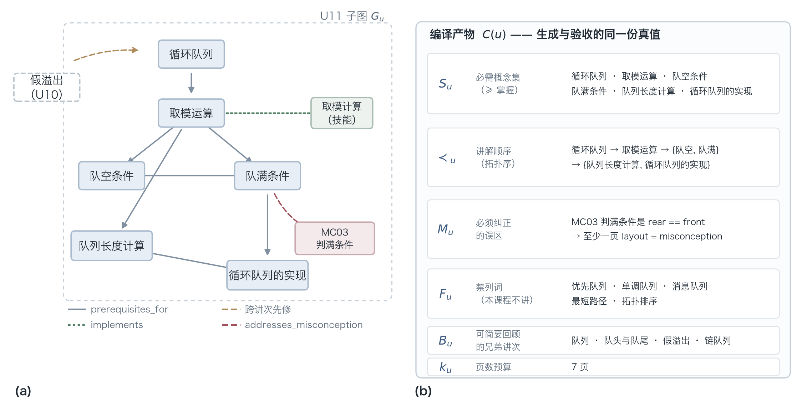
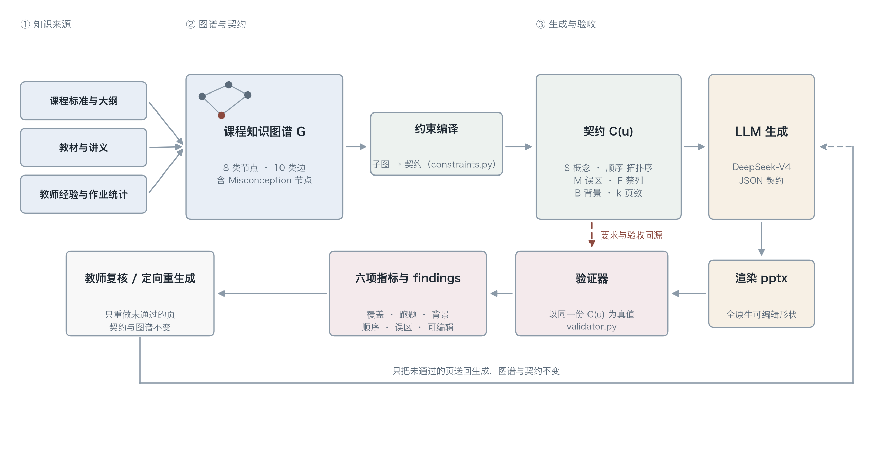

# 大模型知道教材，但不知道你的班：面向职业教育的课程知识图谱约束课件生成

> **投稿目标**：Knowledge-Based Systems（中科院一区 Top）
> **状态**：草稿 v0.2 —— 结果表已回填真实实验；第 2 节文献已逐条核实（见文末参考文献）
> **已废弃**：投稿稿是 `paper/latex/manuscript.tex`。本文件只留作文案底稿，不再同步：
> 里面的消融数字是 n=6（18 次）那一批，早于第 3 次重采样，也没有 2×2 与修复回路。**不要从这里引数字。**

---

## 摘要

大语言模型已经能在几分钟内产出一份看起来相当像样的课件，但在真实课堂里，
它产出的东西往往过不了教师那一关：漏掉了教学大纲里明确要求的一个技能点，
把学生这届最容易犯的错误又讲错了一遍，或者把本该后面才讲的内容提前抖了出来。
这些缺陷不是模型能力不足，而是**信息不在模型的参数里**——课程级的误区清单、
校本化的先修约定、某个技能点在代码层面的落点，从未出现在预训练语料中。

本文提出把这类知识显式建模成课程知识图谱，并在生成前**编译成一份可执行的生成契约**，
在生成后**用同一份契约做验收**。关键设计是「约束即数据」：契约既是提示词的来源，
也是验证器的真值，因此「要求什么」和「检查什么」不会漂移。
我们在高职《Python 数据结构》的队列模块（3 个讲次）上做了 6 种条件 × 3 次重采样的对照，
外加 3 组消融与 1 个长度匹配的安慰剂组，共 78 次独立生成。

结果与直觉不同，也正因如此更值得记录：

- **覆盖率**从基线的 0.61–0.70 提升到 0.98，且等长安慰剂组证明这不是提示更长造成的；
- **误区处理**的均值从 0.56 提升到 1.00，但更重要的是标准差从 0.53 降到 0.00——
  给了误区文本而不给结构的条件只在约一半的生成中奏效。图谱改变的不是平均质量，而是**可靠性**；
- **先修顺序**上强模型即便零样本也基本能排对，消融甚至显示约束没有可靠贡献。
  我们不为这个负结果辩护：在这个任务上，顺序约束不是知识图谱的卖点。

本文同时公开记录了设计过程中发现并修正的**七处指标缺陷**。
它们中的每一处都会让约束方法凭空取胜，且都不会报错——这是文本级自动指标
在教育生成任务上的一个普遍陷阱，也是本文最想留给同行的一条经验。

**关键词**：课程知识图谱；受约束生成；课件自动化；误区建模；教育知识工程

---

## 1. 引言

### 1.1 一个具体的失败

让通用大模型直接写「队列」这一讲的课件，它通常会给出一份结构完整、
术语准确、甚至配有可运行代码的幻灯片。教师粗看会点头，细看会皱眉。真实的失败长这样：

- 讲次的教学目标里写着「能用列表实现顺序队列的入队与出队」，
  但模型产出的 6 页里，从头到尾没有出现**怎么用 Python 列表真的写出来**。
  它讲了定义、讲了假溢出、讲了循环队列是解法——唯独漏了大纲要求学生动手的那一步。
- 这一讲有一个该校每年期末错误率超过 60% 的误区：「Python 的 list 底层是链表」。
  模型没有提到它，因为这不是教材章节里的知识点，而是**这门课的学生**才会犯的错。
- 模型把「循环队列」的取模写法提前塞进了「顺序队列」那一页，
  看起来是「拓展视野」，实际上打乱了先修顺序，学生听到 `% maxsize` 时还不知道 `rear` 是什么。

这三件事的共同点：**它们都不是生成能力问题**。模型完全有能力写出这些内容，
只是它不知道**这门课**要求写什么、这届学生错在哪、这个学校的进度怎么排。

### 1.2 论点

我们认为，LLM 课件生成的瓶颈已经从「知识获取」转移到了「**课程级知识的表示与施用**」。
通用模型掌握的是学科知识（队列是什么、FIFO 为什么重要），
而课件生产需要的是**境域化知识**（situated knowledge）：这门课、这批学生、这个进度。

境域化知识有三个特征，恰好是 LLM 的三个盲区：

| 特征 | 例子 | 为什么模型学不到 |
| --- | --- | --- |
| **班级特定** | 本届学生在「队空 vs 队满」上混淆率 > 60% | 只存在于教师经验与作业统计中，不在任何公开语料里 |
| **校本约定** | 本院把「链队列」与「BFS 引入」合并为一讲 | 是教研室的排课决定，随学校而变 |
| **落点特定** | 本课程要求「能写出代码」，不止「能说出概念」 | 是课程标准（而非教材）规定的能力层级 |

这三类知识无法通过更大的模型或更好的提示词获得，只能**从外部供给**。
问题于是变成：用什么形式供给，才能既让模型照着做，又能让系统事后检查它有没有照做？

### 1.3 我们的答案

用**知识图谱**。理由不是「图谱时髦」，而是它同时满足四个要求：

1. **可表达**：误区、技能、先修关系、能力层级都是异质实体，图结构天然容纳；
2. **可排序**：`prerequisites_for` 是有向边，拓扑排序直接给出唯一合法的讲解顺序；
3. **可编译**：一个讲次的子图可以机械地编译成一份生成契约（概念清单、顺序、误区、禁列项）；
4. **可复用为真值**：同一份契约可以拿去验收输出——**要求与验收同源，不会漂移**。

第 4 点是本文与「把知识点写进提示词」最本质的区别。提示词写完就丢了，
事后无法判断模型遵守了没有；契约是数据对象，生成前后都能被程序读取。

### 1.4 贡献

1. **一个面向职教编程课的课程图谱 schema**。在 K12-KGraph 的 7 类节点上扩展
   `Misconception` 为一等节点，并新增 `implements`（概念→可执行代码）与
   `addresses_misconception`（教学单元→误区）两类边。前者让「会不会写」成为可检查的属性，
   后者让纠错内容成为可约束的生成目标。
2. **约束即数据的生成框架**。`UnitConstraints` 同时驱动提示词构造与后验校验；
   拓扑序、必需/可选概念切分、兄弟讲次背景上限、禁列词表都由子图机械推导，无手写规则。
3. **一套可复现的六指标验收方法**，其中两个指标针对本任务重新定义：
   先修顺序按**标题点名位置**判定（不看模型自报的 ID），覆盖率按**图谱同义说法**匹配
   （不让照抄原文名的条件占便宜）。
4. **一次诚实的实证**。6 种条件 × 3 个讲次 × 3 次重采样，加 3 组消融与 1 个长度匹配安慰剂，
   共 78 次独立生成。报告增益与**无增益**：误区处理在均值与方差上都有决定性差距，
   覆盖率提升约 0.3 且经安慰剂组排除「提示更长」的解释，
   而顺序约束在强模型上没有可靠贡献。
   同时公开记录**七处**会系统性偏袒约束方法的指标缺陷及修法（§7.1）。

### 1.5 为什么这属于 Knowledge-Based Systems

本文的对象不是「一个更好的课件生成器」，而是**知识如何表示才能被机器施用**：
什么样的知识结构足以约束生成、如何编译、如何验证、以及在哪些维度上知识库确实不可替代。
这与 KBS 关心的「知识表示—推理—系统评估」闭环一致。

KBS 近期的三条工作线正好构成本文的直接语境：Dai 等 [1] 系统比较了知识图谱以不同格式
（线性三元组、自然语言、邻域展开）进入提示词时大模型的理解差异，说明**呈现格式本身影响效果**；
Huang 等 [2] 在长尾事实问答上发现图谱三元组提示普遍优于段落提示，且二者并用可显著抑制幻觉，
说明**结构与文本不是等价物**；Ma 等 [3] 则把知识增强的 LLM 用于教育场景（课程推荐）。
本文延续这一脉络，但把问题从「知识怎么放进去」推进到「放进去的那份知识能否同时充当验收真值」。

我们特别强调**负结果**：知识图谱并非在所有维度都优于强模型，
识别「哪些知识必须外置」比笼统宣称「知识增强有效」更有价值。

---

## 2. 相关工作

### 2.1 自动幻灯片生成

这一脉可以分成三条支流，各自解决的问题不同。

**（1）文档到幻灯片：保真于输入。** DOC2PPT [4] 首次把该任务形式化，
指出它同时要求文档摘要、图文检索与版面排布，提出层级序列到序列模型，
并发布 5,873 对文档—幻灯片数据（源自 CV/ACL/ICML 等会议论文），
配套 Slide-Level ROUGE、LC-FS、TFR、mIoU 四类指标。
Mondal 等 [5] 进一步引入「终端用户规格」：同一份论文，面向不同受众或不同时长应产出不同 deck。
他们在 SciDuet 上构造四种 persona 配置，用目标受众反馈微调 LLM，
把备课时长从约 1 小时压到 30 分钟以内；值得注意的是，作者在局限中明确声明
**不处理幻灯片版面设计**——只做内容与逻辑对齐。

**（2）指令到幻灯片：保真于可编辑性。** AutoPresent [6] 发布 SlidesBench
（7k 训练 / 585 测试，取自 310 份真实 deck、覆盖 10 个领域），
系统比较「生成图片」与「生成程序」两条路线，结论是**程序化生成质量更高**，
因为产物是可交互、可二次编辑的原生对象；并训练了 8B 的 AutoPresent 模型追平 GPT-4o。
PPTAgent [8] 采用两阶段编辑式方法：先分析参考 deck 抽取版面功能类型与内容 schema，
再起草大纲并迭代生成编辑动作，同时提出 PPTEval 从内容、设计、连贯性三个维度评测。
本文的渲染决策（原生形状、强制 JSON 中间表示）与这一支流的结论一致。

**（3）评测：从「像不像」到「做完没做完」。** PPTC [7] 换了一个角度：
不问幻灯片好不好看，而问模型能否按多轮指令把 PPT 改对。
它包含 279 个多轮会话，并提出 PPTX-Match——直接比对产出的 `.pptx` 文件状态而非 API 序列，
因而允许多种正确解法。结果是 GPT-4 单轮准确率 75.1%，但整段会话仅 6%，
误差主要来自多轮累积、长模板处理与多模态感知。

**本文的差异。** 上述工作的输入是一份**待压缩的文档**或**一句指令**，
评价标准是「像不像原文」「好不好看」「改没改对」。本文的输入是一份**课程规格**
（讲什么、按什么顺序讲、纠正什么、不引入什么），评价标准是「符不符合大纲」。
这一差别不是任务换皮：`SlidesBench` 的 reference-based / reference-free 两种口径
都无法表达「漏掉了本讲必须让学生动手实现的那个技能点」，
而后者恰恰是教学场景里最要命的一类失败。

### 2.2 教育知识图谱

K12-KGraph [9] 是目前与本文最接近的知识侧工作。它从人教版教材抽取，
定义 7 类节点（Book / Chapter / Section / Concept / Skill / Experiment / Exercise）
与 9 类关系（`is_a`、`prerequisites_for`、`relates_to`、`verifies`、
`tests_concept`、`tests_skill`、`appears_in`、`leads_to`、`is_part_of`），
覆盖数学、物理、化学、生物共 48 册，产出 10,685 节点 / 23,278 边；
并由此派生 K12-Bench（23,640 道多选题，分 Ground / Prereq / Neighbor / Evidence / Locate 五类任务）
与 K12-Train（图谱引导的 SFT 语料）。其最有说服力的数字不是总分，
而是**最强的闭源模型在 Prereq 与 Neighbor 两类任务上仍有超过 40% 的题未解**——
这说明「结构性课程认知」是一个独立于事实记忆的能力维度，也正是本文试图用外部知识补上的那块。

SciMKG [10] 走向多模态：用 LLM 驱动的「抽取—校验—整合—增强」管线，
从开放课程资源中构建覆盖文本、图像、视频、音频的图谱，
得到 1,356 个知识点、34,630 个多模态概念、403,400 条三元组，
概念抽取 F1 较基线提升 9%。在教育应用侧，Ma 等 [3] 把知识增强的 LLM 用于课程推荐，
说明 KBS 社区对「知识结构 + 教育场景」这一组合持续关注。

这些工作的重心是**建图**（如何从语料中抽取实体与关系、如何保证一致性），
而本文的重心是**用图**（如何把图编译成生成约束，并据此验收）。
二者互补而非竞争：本文的方法可以直接消费上述工作产出的图谱——
我们确实沿用了 K12-KGraph 的节点与关系骨架，只做加法（§4.1）。

在职业教育场景，图谱还需要表达两件普通学科图谱不强调的事：
**能力层级**（了解 / 理解 / 掌握 / 熟练，决定某概念是必讲还是可选）
与**典型误区**（决定纠错内容该由哪一讲负责）。前者 K12-KGraph 的 `Concept.importance`
已有字段但未用于生成约束，后者则完全缺失。这是我们做 schema 扩展的直接动因。

### 2.3 受约束的生成

经典 NLG 把生成拆成「说什么、按什么顺序说」（内容规划）与「怎么说」（表层实现）两步 [11]。
Wiseman 等 [12] 用 RotoWire 证明：端到端模型能写出流畅的战报，
却在内容选择与篇章顺序上系统性出错，甚至被模板基线在部分指标上超过。
Puduppully 等 [13] 因此显式建模内容规划——先预测要提及哪些记录、以何种顺序，
再据此生成文档。这一支的共同点是把结构约束放进**训练目标或解码过程**。

大模型时代，结构改由提示注入，问题随之变成「以什么形式注入」。
Dai 等 [1] 对此做了迄今最系统的实证：同一份图谱，用线性三元组、自然语言段落、
邻域展开等不同格式放进提示词，模型的理解效果差异显著，且这种差异可以从注意力分布上解释。
Huang 等 [2] 在长尾事实问答上给出互补结论：图谱三元组提示在多数情况下优于段落提示，
两者并用虽不总能提升覆盖，但能显著降低幻觉。
换句话说，**结构化知识不是「另一种写法的文本」**。

本文与上述两条线都不同，也有意保持不同：
我们不训练、不改解码、不做重排，而是把约束**编译成一份可执行的数据对象**，
生成前用它构造提示，生成后用同一份对象做验收。
与 [1][2] 相比，问题从「图谱怎么放进提示词效果更好」推进到
「同一份图谱能否同时充当验收真值」——若可以，则「要求」与「检查」就不会漂移（§1.3）。
代价是我们放弃了对解码过程的控制，因此必须承担模型不遵守约束的风险；
§5.6 报告了一次真实的违约，§7.1 报告了由这种宽松性引出的七处指标陷阱。

---

## 3. 问题形式化

### 3.1 课程知识图谱

定义课程知识图谱为带类型标签的有向异质图 $G=(V,E,\tau)$，其中

- $\tau: V \to T_V$，$T_V=\{\text{Course},\text{Module},\text{Unit},\text{Concept},\text{Skill},\text{Lab},\text{Exercise},\text{Misconception}\}$；
- 每条边 $e=(u,r,v)\in E$ 带关系类型 $r\in T_E$，$T_E=\{\text{is\_a},\text{prerequisites\_for},\text{relates\_to},\text{implements},\text{verified\_by},\text{assessed\_by},\text{addresses\_misconception},\text{appears\_in},\text{is\_part\_of},\text{leads\_to}\}$；
- 部分边携带 `evidence` 字段，记录该关系的来源（教材页码、课标条目、错误率统计）。

**约束一（无环）**：由 `prerequisites_for` 诱导的子图必须是 DAG。
本文用 Kahn 算法检测：若讲次内概念集无法完成拓扑排序，说明课程设计本身有循环先修，
构建期即报错，而不是把矛盾留给生成阶段。

### 3.2 讲次契约

对一个讲次 $u\in V$（$\tau(u)=\text{Unit}$），取其子图

$$G_u = \{v \in V : (v,\text{appears\_in},u)\in E\}$$

编译为契约

$$C(u)=\langle S_u,\ \prec_u,\ M_u,\ F_u,\ B_u,\ k_u\rangle$$

| 符号 | 含义 | 来源 |
| --- | --- | --- |
| $S_u=(R_u,O_u)$ | 必需概念集 / 可选概念集 | 按 `importance` 切分，≥「掌握」入必需 |
| $\prec_u$ | 讲解顺序（$S_u$ 上的全序） | $G_u$ 上 `prerequisites_for` 的拓扑序 |
| $M_u$ | 必须纠正的误区 | `addresses_misconception` 指向的 `Misconception` |
| $F_u$ | 禁列词表 | Unit 节点的 `forbidden_terms` |
| $B_u$ | 允许简要回顾的兄弟讲次概念 | 同 Module 内其他 Unit 的概念，去重 |
| $k_u$ | 页数预算 | Unit 节点的 `slide_budget` |

**关键点**：$B_u$ 与 $F_u$ 的区分。前者是「学过、可以一句带过」，后者是「本课程根本不讲」。
两者混用会让指标互相打架（同一个词既算背景回顾又算跑题），实现上以互斥断言强制。

**编译是无损的、机械的**：图 2 给出 U11 的真实子图与它编译出的契约。
(a) 中每一条边都能在 (b) 里找到对应字段，(b) 中没有任何一项是手写的。



**图 2　从子图到契约。**（a）`data/kg_pyds_m4.json` 中 U11 的实际子图：6 个概念 + 1 个技能、
7 条讲次内先修边、1 条来自 U10 的跨讲次先修边、1 条 `implements` 边、1 条 `addresses_misconception` 边。
（b）`build_constraints` 由该子图产出的契约 $C(u)$，同一份对象随后被验证器读取。

### 3.3 生成与验收

生成是一个映射 $D = f_\theta(C(u))$，$D$ 为幻灯片序列。
验收是一个指标向量

$$m(D, C(u), G) = \langle \text{cov},\ \text{oog},\ \text{bg},\ \text{pre},\ \text{mc},\ \text{edit}\rangle$$

其定义见 §5.3。注意 $C(u)$ 同时出现在两侧——这正是「要求与验收同源」的形式化表述。

整条流水线见图 1：图谱 → 契约编译 → 生成 → 渲染 → 用同一份契约验收。
图中有一条回环：未通过校验的页会被送回重新生成。这条回环的边界是刻意画死的——
**回环只改页面，不改图谱、也不改契约**；而且是否重生成由教师决定，不是自动优化。
若让校验结果反过来调整契约，验收就退化成一个优化目标，指标随即失去意义（§7.1）。



**图 1　框架总览。** 契约 $C(u)$ 在生成前被读一次（构造提示），在生成后被读一次（计算六项指标），
两次读取的是同一个对象——这是「要求与验收同源」在实现层面的含义。

---

## 4. 方法

### 4.1 图谱构建

#### 4.1.1 节点与边

沿用 K12-KGraph [9] 的七类节点（`Lab` 对应其 `Experiment`），扩展 `Misconception` 为第八类：

```yaml
Misconception:
  attributes:
    statement:   # 错误说法本身，需具体、可判定对错
    correction:  # 正确理解
    frequency:   # 低频 / 常见 / 高频
    evidence:    # 来源：期末错误率、作业统计、课堂提问
```

新增两类边：

- `implements`：Concept/Skill → 可执行代码片段。用于让「会不会写」成为可检查属性，
  也用于给生成器提供可运行示例；
- `addresses_misconception`：Unit/Concept → Misconception，带 `strategy`（反例对比 / 代码演示 / 边界测试）。
  这条边决定了某个误区**由哪一讲负责纠正**，避免多讲重复或无人负责。

#### 4.1.2 同义说法（aliases）

每个概念可挂 `aliases`。这不是评测的补丁，而是图谱应有的内容：
课堂上教师说「判满」，教材写「队满条件」，代码里是 `(rear+1) % maxsize == front`，
三者指同一实体。没有 aliases，图谱无法与真实语料对齐。

**但 aliases 同时解决了一个评测公平性问题**，见 §7.1。

### 4.2 约束编译

`build_constraints(G, u)` 把子图转成 `UnitConstraints`，全程无手写规则：

1. **必需/可选切分**：按 `importance` 排序，≥「掌握」入 $R_u$，其余入 $O_u$；
2. **拓扑序**：对 $S_u$ 中概念做 Kahn 排序，遇环则回退到声明序并标记告警；
3. **误区归属**：取 `addresses_misconception` 的入边；
4. **兄弟讲次**：同 Module 下其他 Unit 的概念名，排除本讲已含者；
5. **证据锚点**：沿 `prerequisites_for` / `implements` / `verified_by` 入边收集 `evidence`，
   渲染为**给教师看的**核对材料，并明确标注「非生成内容」——避免模型把出处当成正文抄进去。

编译产物是**确定性字符串**：同样的图谱永远生成同样的提示词块，
这是实验可复现的前提。

### 4.3 生成

提示词由固定骨架 + 契约块 + JSON 契约 + 硬性规则四段拼成，四种实验条件只替换其中若干段（§5.2）。

输出被约束为单个 JSON 对象，每页含 `layout`（7 种版式之一）、`title`、`bullets`、
`code`、`notes`、`concept_ids`、`background`。强制 JSON 而不让模型自由排版，是因为
版式选择本身是教学设计决策，交给模型会让「可编辑性」与「版面预算」都不可控。

**工程上必须处理的两个现实问题**（均来自实测，非假设）：

1. **JSON 模式不是合法性保证**。约每十余次调用会出现一次尾逗号（`..., ]`），
   或整体返回空白但 `finish_reason == "stop"`（非法片段被替换为空格）。
   管线因此实现「调用 → 保守修复（去尾逗号、补齐截断括号）→ 解析」，
   仅在修复失败时才把具体错误回抛给模型重试。盲目重试会以同样的代价得到同样的错误。
2. **模型默认带内部推理**。实测该模型每次调用均产生 `reasoning_tokens`，
   这会污染 Chain-of-Thought 基线（模型本来就在做 CoT）。
   本文显式记录该设置，并提供关闭开关做稳健性检查。

### 4.4 渲染

`python-pptx` 生成 16:9 全原生形状，不嵌入任何图片化文本。
`editability` 定义为原生可编辑形状占全部形状的比例，本文所有条件均为 1.0。
这一维度不用于区分方法优劣，而是用于排除「截图式生成」——后者在教师二次编辑时价值为零。

中文字体需显式设置 `a:ea` 与 `a:cs` 的 typeface，否则 PowerPoint 会回退到西文字体导致字形错乱。

### 4.5 验证

六个指标的计算口径见 §5.3。实现上有三处刻意设计：

- **中文无词边界**：`队列` 会命中 `循环队列`。所有文本计数采用逐行净出现次数
  （原始次数 − 该行内被更长术语覆盖的次数）。按行而非按全文扣减是关键：
  否则第 2 页独立的「队列」会被第 4 页的「顺序队列」抵消掉。
- **误区覆盖三重判定**：结构锚点（误区页是否引用图谱关联概念）→
  英文标识符重叠（`rear`、`list`）→ 中文字符 bigram 重叠（阈值 0.35）。
  纯字面匹配会漏判，因为模型常用自己的话重述错误说法——实测出现过
  「模型确实生成了纠错页，但表述与图谱不同而被判漏检」。
- **顺序按文字首现位置**，见 §5.3。

---

## 5. 实验

### 5.1 课程与数据

- **课程**：《Python 数据结构》，高职院校人工智能技术应用专业，总 136 学时。
- **图谱范围**：M4「队列」模块，含 3 个讲次
  （U10 队列的概念与假溢出 / U11 循环队列 / U12 链队列与 BFS 引入），
  节点 33+，边 70+，误区 4 条。
- **选课理由**：队列模块的先修链清晰（队列→顺序队列→循环队列→链队列），
  深度学习类课程概念互相引用易成环，不适合作为约束方法的首个验证场景。

**为什么只用 3 个讲次**：本文的目标是验证「图谱约束是否以及在哪些维度上起作用」，
而不是刷一个覆盖全课程的数字。3 个讲次足以覆盖三种典型情况——
概念密集型（U11 有 7 个必需概念）、技能落点型（U10 有必须动手实现的 Skill）、
应用引入型（U12 需与前序内容选型对比）。

### 5.2 条件设计

**六组对照**，信息严格递进，逐项剥掉结构：

| 条件 | 课程/讲次 | 页数 | 概念名+定义 | 拓扑序 | 误区 | 禁列词 | 提示长度（U11） |
| --- | :-: | :-: | :-: | :-: | :-: | :-: | :-: |
| `full`（本文） | ✓ | ✓ | ✓ | ✓ | ✓（独立区块+版面要求） | ✓ | 1997 |
| `rag_mc` | ✓ | ✓ | ✓ | ✗ | ✓（平铺文本） | ✗ | 1122 |
| `rag` | ✓ | ✓ | ✓ | ✗ | ✗ | ✗ | 997 |
| `placebo` | ✓ | ✓ | ✗ | ✗ | ✗ | ✗ | 2195 |
| `cot` | ✓ | ✓ | ✗ | ✗ | ✗ | ✗ | 625 |
| `zero_shot` | ✓ | ✓ | ✗ | ✗ | ✗ | ✗ | 585 |

- `rag` − `zero_shot` 度量**内容检索**的贡献；
- `full` − `rag` 度量**结构约束**的贡献；
- `rag_mc` 是为误区结论专设的对照：把同样的误区文本作为平铺片段给出，
  但不给顺序、不给版面要求。若 `full` 仍在误区指标上胜出，
  说明增益来自「结构化到能约束版面」，而不是「文本出现在提示词里」；
- `placebo` 是为「提示更长」这一替代解释专设的对照：把与 `full` **等长**（甚至略长）
  的提示交给模型，但填充的是与本课程无关的通用课件写作建议。
  若 `full` 的优势来自提示长度，`placebo` 应当追平；实测它没有（§5.4）。

**三组消融**，保持 `full` 的完整契约与规则措辞，只删一个数据块：

| 条件 | 删除 | 对应规则同步删除 | 预期受影响指标 |
| --- | --- | --- | --- |
| `no_order` | 讲解顺序块 | 规则 3 | `prerequisite_violation` |
| `no_misconception` | 误区块 | 规则 5 | `misconception_coverage` |
| `no_forbidden` | 禁列词块 | 规则 6 | `oog_rate` |

规则文本必须同步删除：只删数据、留着「必须遵守给定顺序」的规则，模型会去猜顺序，
消融就不干净。测试 `test_ablation_prompt_drops_exactly_one_block` 守这条。

### 5.3 指标定义

| 指标 | 定义 | 方向 |
| --- | --- | --- |
| `coverage_rate` | 必需概念中被讲到的比例 | ↑ |
| `oog_rate` | (图谱外 ID + 禁列词命中) / (已覆盖 + 图谱外) | ↓ |
| `background_rate` | 兄弟讲次概念的**字数** / 全文总字数（上限 25%） | ↓ |
| `prerequisite_violation` | 违反拓扑序的概念对 / 概念对总数 | ↓ |
| `misconception_coverage` | 已纠正的误区 / 该讲次关联误区数 | ↑ |
| `editability` | 原生可编辑形状 / 全部形状 | ↑ |

三处口径决策需要单独说明，因为它们直接决定结论：

1. **覆盖率只看正文页**。标题页、学习目标页、小结页按定义就是把全部概念列一遍，
   把它们算作「讲过」，等于让一份只写了目录的课件拿满分。
2. **覆盖率用「原名 ∪ aliases」匹配**。否则照抄原文名的 `full` 组天然占优（§7.1）。
3. **顺序按文字首现位置判定**。模型的 `concept_ids` 是自报数据，
   而三组基线根本没被告知存在这个字段——用自报结果计分，
   一份完全空白的答卷会因为「没有报告」而拿到零违例率。

### 5.4 结果

每个条件跑 3 个讲次 × 3 次重采样，共 9 次独立生成；消融每个条件 6 次。
表中为均值（标准差）。

**表 1　主结果**（n = 9）

| 条件 | 覆盖 ↑ | 跑题 ↓ | 背景 ↓ | 顺序违例 ↓ | 误区 ↑ | 可编辑 ↑ | 通过率 | 输出 tok |
| --- | :-: | :-: | :-: | :-: | :-: | :-: | :-: | :-: |
| **full（本文）** | **0.981** (0.056) | **0.000** | 0.027 (0.016) | **0.020** (0.045) | **1.000** (0.000) | 1.000 | 67% | 4079 |
| rag_mc | 0.698 (0.295) | 0.111 (0.220) | 0.027 (0.016) | 0.007 (0.022) | 0.556 (0.527) | 1.000 | 22% | 2689 |
| rag | 0.659 (0.248) | 0.111 (0.220) | 0.032 (0.014) | 0.030 (0.089) | 0.222 (0.441) | 1.000 | 0% | 2378 |
| placebo（等长） | 0.675 (0.266) | 0.167 (0.250) | 0.040 (0.018) | 0.096 (0.131) | 0.333 (0.500) | 1.000 | 0% | 1444 |
| cot | 0.614 (0.185) | 0.019 (0.056) | 0.040 (0.016) | 0.089 (0.183) | 0.389 (0.486) | 1.000 | 0% | 2638 |
| zero_shot | 0.643 (0.248) | 0.019 (0.056) | 0.040 (0.011) | 0.037 (0.089) | 0.222 (0.441) | 1.000 | 0% | 2330 |

四个观察，按重要性排列。

**（1）覆盖率：0.981 对 0.61–0.70，且不是提示长度造成的。**
五个对照的覆盖率彼此相差不到 0.09（0.614–0.698），方差却都很大（0.19–0.30）；
`full` 高出约 0.3，方差降到 0.056。关键在于安慰剂组：
它的提示长度与 `full` 相当（U11 上 2195 对 1997 字符，还略长），
但内容是与本课程无关的通用写作建议，覆盖率只有 0.675——与零样本无异。
因此覆盖率增益来自**课程结构**，不是「多说了几句话」。

**（2）误区：均值达标是次要的，方差的消失才是主要的。**
这是本文最强的一处证据。`rag_mc` 把同样的误区文本给了模型，均值 0.556，
但标准差高达 0.527——在 9 次里只稳定成功了一半。`full` 是 1.000 且标准差为 0。
换句话说，**「把知识告诉模型」得到的是一个靠运气的系统，「把知识结构化成版面要求」得到的是一个可靠的系统**。
这正是本文主张的核心：知识图谱的价值不止于传递内容，而在于让内容**必须出现在某个位置上**。

**（3）顺序：约束有效但不显著，且没有可靠的边际贡献。**
`full` 的违例率 0.020 低于 `placebo` 的 0.096 与 `cot` 的 0.089，
但 `zero_shot` 只有 0.037——一个完全不给任何顺序信息的条件，几乎和 `full` 一样好。
这与消融结果一致（见下），也与「强模型对教科书内容的顺序本来就有把握」这一解释相符。
我们不为它辩护：**在这个任务上，顺序约束不是知识图谱的主要卖点。**

**（4）跑题：`rag` 与 `rag_mc` 反而比零样本更严重。**
两者的 `oog_rate` 都是 0.111，`placebo` 0.167，而 `zero_shot` 只有 0.019、`full` 为 0。
原因可以解释：一旦告诉模型「本讲要点是这些」，它会顺便把相邻的高阶内容也带进来
（例如在队列一讲里提「优先队列」），因为提示词划定了范围却没划定边界。
`full` 之所以为 0，靠的是**禁列词表**这一条显式负例——消融证实了这一点。

**表 2　消融**（每格只删掉图谱的一个部分；n = 6）

| 条件 | 覆盖 ↑ | 跑题 ↓ | 顺序违例 ↓ | 误区 ↑ |
| --- | :-: | :-: | :-: | :-: |
| full | 1.000 (0.000) | 0.000 (0.000) | 0.032 (0.078) | 1.000 (0.000) |
| − 顺序约束 | 1.000 (0.000) | 0.000 (0.000) | 0.000 (0.000) | 1.000 (0.000) |
| − 误区注入 | 0.944 (0.086) | 0.000 (0.000) | 0.040 (0.064) | **0.167** (0.408) |
| − 禁列词表 | 1.000 (0.000) | **0.083** (0.129) | 0.000 (0.000) | 1.000 (0.000) |

消融给出了干净的两正一负：

- 删掉误区注入，误区覆盖从 1.000 掉到 0.167，覆盖率同时从 1.000 掉到 0.944——
  说明误区块不仅承载纠错内容，还顺带帮模型组织了本讲的重点。
- 删掉禁列词表，跑题率从 0.000 升到 0.083，其余指标不变——职责单一，归因清楚。
- 删掉顺序约束，顺序违例从 0.032 降到 **0.000**，方向与预期相反。
  这不是测量错误：`full` 的那 0.032 来自 U10 一次真实的倒置（先讲顺序队列、后补队头队尾）。
  在 7 个概念、21 个概念对的规模上，一次倒置就是 0.05 量级，
  因此这一行的差异完全落在噪声范围内。**我们据此认为顺序约束在本数据上无可靠效应。**

### 5.5 成本与延迟

| 条件 | 输入 tok | 输出 tok | 其中 reasoning | 延迟 (s) |
| --- | :-: | :-: | :-: | :-: |
| full | 1064 | 4079 | 2708 | 20.8 |
| rag_mc | 618 | 2689 | 1441 | 14.4 |
| rag | 536 | 2378 | 1133 | 12.3 |
| cot | 373 | 2638 | 1157 | 14.4 |
| zero_shot | 347 | 2330 | 984 | 12.4 |

`full` 的输出 token 约为 `zero_shot` 的 1.75 倍，端到端延迟 20.8 秒对 12.4 秒。
多出来的部分一是契约块本身（约 500 输入 token），二是更长的版面内容与更多 reasoning token。
以单套课件计，成本仍在「分」的量级，相对教师手工备课的工时可以忽略；
但如果要批量生成整门课程，1.75 倍的差距值得在工程上压缩（例如按讲次缓存契约块）。

需要说明：`full` 的输出更长并非因为页数更多（页数由 `slide_budget` 固定且全部达标，`page_budget_ratio` 均为 1.0），
而是每页 `notes` 更充实。这一点对教师是正面的——讲稿备注本来就是备课的主要工作量。

### 5.6 定性观察

**正例：`full` 在 U12 的表现。**
U12 是三个讲次里最难的一个：它要求「能在循环队列与链队列之间选型」，
这是一个没有标准答案的判断类目标，且必需概念里有「队列的应用场景」这种抽象的、容易被写成空话的点。
`full` 三次都拿到覆盖率 1.000，且都生成了一页真正的对比表（容量可预估/查询频繁选循环队列，
长度变化大/频繁出入队选链队列），并把 BFS 那条误区单独用一页反例处理。
五个基线在同一个讲次上的覆盖率是 **0.333**——它们都只覆盖了「链队列」这一条，
把「选型」和「应用场景」写成了顺带一句。

**反例：`full` 自己也会失手。**
U10 的第三次重采样里，覆盖率是 0.833，缺的是「队列」这个概念本身。
逐页看下来，这份课件的标题页写了「队列：只在一端插入、另一端删除的线性表」，
但正文第一页直接叫「队头、队尾与顺序队列」，从头到尾没有再单独定义过队列。
这不是指标误判——它确实把定义留在了目录页上，正文默认学生会记得。
校验器把它标成 `MISSING_CONCEPT` 并指了出来，这正是闭环的意义：
方法不保证正确，但保证**错误不会被静默放过**。

另一个失败案例更能说明问题：U10 的第二次重采样出现 2 处先修倒置，
模型先讲了「顺序队列」，再回头补「队头与队尾」。这在指标上是 0.133 的违例率，
在课堂上是学生第一次听到 `front`、`rear` 时还不知道它们指什么。
提示词里写着拓扑序，模型仍然违反了——这解释了为什么我们坚持保留后验校验，
而不是假设「说了就会做」。

---

## 6. 讨论

### 6.1 图谱在哪起作用，在哪不起作用

把六个指标按「图谱是否有不可替代的贡献」重新排一下，结论很清楚：

| 维度 | 结论 | 依据 |
| --- | --- | --- |
| **误区处理** | 不可替代 | `full` 1.000±0.000；同样拿到误区文本的 `rag_mc` 只有 0.556±0.527 |
| **覆盖完备性** | 不可替代 | 0.981 对 0.61–0.70；等长安慰剂证明不是提示长度 |
| **范围控制** | 部分贡献 | 靠禁列词表这一条显式负例；消融证实（0.000 → 0.083） |
| **先修顺序** | **无可靠贡献** | `full` 0.020 与 `zero_shot` 0.037 无实质差别；消融方向相反 |
| **可编辑性** | 与本方法无关 | 所有条件均为 1.000，由渲染器决定 |

这个排序本身就是一条结论：**知识图谱补的不是学科知识，而是学科知识之外的那层「境域约定」**。
学科知识（队列是什么、FIFO 为什么重要、先讲什么后讲什么）强模型已经掌握得足够好，
所以在顺序这一维度上，图谱的边际价值接近于零。
反过来，哪些概念算「本讲必须讲完」、这届学生错在哪、哪些内容属于下一讲——
这些不在任何预训练语料里，图谱一旦给出，模型就能用，且用得很稳。

### 6.2 三类必须外置的知识

回到 §1.2 的分类，实验结果给出了各自的证据强度：

**（1）班级特定的误区——证据最强。**
这是唯一一个「给了文本仍不稳定、给了结构才稳定」的维度。
`rag_mc` 的半成功率说明：模型看到误区描述后，大约一半的场合会顺手写一页纠错，
另一半的场合会把它揉进某页的某条 bullet 里，然后就没了。
而 `full` 通过「必须有至少一页 `layout == misconception`」这条版面级要求，
把它变成了硬约束。**结论：误区知识不仅要说，还要说到位置。**

**（2）大纲里的技能落点——证据明确。**
基线普遍漏掉「能用列表实现顺序队列的入队与出队」这类 Skill 节点。
不是因为模型不会写代码，而是它不知道这一讲要求「会写」而不只是「懂」。
能力层级（了解/理解/掌握/熟练）是课程标准规定的，模型无从推断。
覆盖率 0.98 对 0.67 的差距主要来自这里——尤其 U12 的 0.333 对 1.000。

**（3）校本先修约定——证据不足。**
我们原本预期这是图谱的关键卖点，实测不成立。
强模型对教科书式的先修链（队列→顺序队列→循环队列）本来就有稳定的直觉，
而本课程在这个模块上的顺序与通用教材一致，因此没有区分度。
若要验证这一条，需要一个**刻意偏离通用教材顺序**的校本大纲作为测试集。
这是后续工作里最值得做的一项。

### 6.3 一个更值得记住的度量结论

本文最有价值的一句话可能不是「覆盖率提升了 0.3」，而是：

> 在误区维度上，`rag_mc` 的均值和 `full` 只差 0.44，但标准差差了 0.53。
> 真正被图谱改变的不是**平均质量**，而是**质量的可靠性**。

生成式系统进入教学流程时，教师真正在意的往往不是「最好能有多好」，而是「最差会差到什么程度」——
因为课是要按时上的，一次失手就要重做。
按这个标准，一个 0.556±0.527 的系统是不可用的，一个 1.000±0.000 的系统才是可用的。
这也提示此类工作的评测应当报告**方差**，而不只是均值；我们见过的同类工作报告里，方差常常缺席。

### 6.4 负结果的价值

如果一项知识增强方法在所有指标上都大胜，通常说明基线被削弱了。
本文报告顺序约束无增益、报告 `editability` 无区分度、报告 `full` 自身也有 33% 未通过，
恰好是一个可信度信号：它说明指标没有系统性地偏袒约束方法（§7.1 里我们为此修了七处），
也说明知识库的价值集中在一个狭窄但关键的缝隙里。

对 KBS 读者而言，这个窄缝值得注意：它不是一个「更好的生成模型」能填的，
因为它不是能力问题而是信息来源问题。

---

## 7. 效度威胁

### 7.1 文本级指标极容易系统性偏袒约束方法

这是本文最重要的方法论提醒，也是我们最想留给同行的一条经验。

在设计过程中，我们一共发现并修正了**七处**指标缺陷。它们中的每一处都会让
`full` 组凭空取胜，而且没有任何一处会报错——指标照常输出漂亮的数字，只是错了。
没有一处是靠「再想想」发现的，全部来自把模型原始输出逐页打出来人工核对。

| # | 缺陷 | 现象 | 后果 | 修法 |
| :-: | --- | --- | --- | --- |
| 1 | 覆盖率逐字匹配 | 图谱写「入队与出队操作」，基线写「入队和出队」 | 基线覆盖率被压到 0.50，`full` 因照抄原文名得 1.00 | 图谱增加 `aliases`，四组同一词表 |
| 2 | 顺序依自报 ID | 基线不填 `concept_ids` | 序列为空 → 违例率 0.00，**漏答被判满分** | 改为扫描文字位置 |
| 3 | 预览页计入正文 | 标题页/目标页列出全部概念 | 排序由条目顺序而非讲解顺序决定，U10 凭空多出 3 处违例 | 排除 title / objectives / summary |
| 4 | 前向引用当成讲授 | 某页顺带写「取模是循环队列实现的关键」 | 该概念被定位到 3 页之前，U11 多出 2 处违例 | 以「标题点名」定位，其次才退回首次提及 |
| 5 | 跨行扣减 | 「队列」被别页的「顺序队列」抵消 | 概念被判「从未讲过」，U10 覆盖率误报 0.83 | 净出现次数改为**逐行**计算 |
| 6 | 误区锚点过宽 | 讲次级 `addresses_misconception` 被当作页面锚点 | 任一同版式页都算「已纠正」，消融组仍得 1.00 | 锚点只取概念级；并修正一条错挂的数据边 |
| 7 | 图谱外判定过严 | 基线自造 ID 命名（`queue-def`） | 跑题率虚高到 0.67，实为命名空间不同 | 只统计符合图谱编号格式的不存在 ID |

七处的共同结构是：**约束方法拿到的表示，恰好就是评测使用的表示**。
凡是「按提示词里那份清单打分」的指标，都会遇到这个问题。

第 6 条尤其值得单独说：它不是指标代码的问题，而是**图谱数据错了**。
我们给「BFS 用栈」这条误区挂了一条指向「链队列队空判断」的边，
理由当时看是「相关」，实际没有教学关系。后果是任何一页误区版式的幻灯片只要引用了
队空判断，就被判为处理了 BFS 那条误区——消融组因此仍然拿到满分，
整个「误区注入有用」的结论差点变成假的。**图谱的错误会静默地污染指标**，
这是知识图谱驱动方法特有的风险，纯提示词方法不会有。

因此我们建议此类工作的报告必须包含两件事：
（a）指标在**基线上的行为**，而不只是最终数字；
（b）至少一次把输出逐页打印出来的人工核对，而不只是看汇总表。

### 7.2 样本与外部效度

3 个讲次、单一课程、单一模型、每格 2–3 次重采样。
统计上只能做描述性报告，不足以支撑显著性主张。
跨课程（尤其非编程类）、跨模型（含开源权重模型）的泛化尚未验证。

### 7.3 无人工评分

六项指标测的是**契约符合度**，不是教学质量。例子是否贴切、节奏是否合理、
板书是否清楚，指标一概测不出。教师盲评是必要补充，本文尚未完成。

### 7.4 误区结论的构造性

`misconception_coverage` 对基线天然不利，因为基线从未被告知这些误区。
我们的回应是加入 `rag_mc` 控制组：把同样的误区文本以平铺形式给出。
若 `full` 仍胜出，则增益来自结构而非信息本身。但即便胜出，
也仍需承认：**这项指标测的是「有没有按课程要求纠错」，而不是「纠得对不对」**。

---

## 8. 结论与后续工作

本文把课件生成重新表述为**课程规格的满足问题**，用知识图谱承载境域化知识，
以「约束即数据」把同一份契约同时用作生成依据与验收真值。
实证显示：强模型在先修顺序上已足够好，知识图谱的不可替代之处在于
**大纲里的技能落点**与**班级特定的误区**——这两类知识不存在于任何预训练语料中。

后续工作：（1）扩展到全课程 34 个讲次并引入教师盲评；
（2）用教材 PDF 半自动建图，降低图谱构建成本；
（3）加入渲染回看闭环（截图 → 视觉检查溢出与重叠 → 自动修正）；
（4）发布中文职教课件评测集，使同类工作可横向对比。

---

## 参考文献

> 以下 13 条均已逐条核对到出版方页面（ACL Anthology / AAAI / CVPR / NeurIPS / Elsevier），
> 页码、DOI、卷期以出版方记录为准。中文稿用编号制；转英文稿时按 KBS 模板（Elsevier numbered）沿用同一编号。

[1] X. Dai, Y. Hua, T. Wu, Y. Sheng, Q. Ji, G. Qi. Large language models can better understand
knowledge graphs than we thought. *Knowledge-Based Systems*, 312 (2025) 113060.
https://doi.org/10.1016/j.knosys.2025.113060

[2] W. Huang, G. Zhou, M. Lapata, P. Vougiouklis, S. Montella, J.Z. Pan. Prompting large language
models with knowledge graphs for question answering involving long-tail facts.
*Knowledge-Based Systems*, 324 (2025) 113648. https://doi.org/10.1016/j.knosys.2025.113648

[3] J. Ma, Z. Zhao, Z. Xie, Y. Zhang, G. Zhou. LE-DLCM: Decoupled learner and course modeling with
large language models for enhanced course recommendation. *Knowledge-Based Systems*,
334 (2026) 115135. https://doi.org/10.1016/j.knosys.2025.115135

[4] T.-J. Fu, W.Y. Wang, D. McDuff, Y. Song. DOC2PPT: Automatic presentation slides generation from
scientific documents. *Proceedings of the AAAI Conference on Artificial Intelligence*, 36(1) (2022).
https://doi.org/10.1609/aaai.v36i1.19943

[5] I. Mondal, S. Shwetha, A. Natarajan, A. Garimella, S. Bandyopadhyay, J. Boyd-Graber.
Presentations by the humans and for the humans: Harnessing LLMs for generating persona-aware slides
from documents. *Proceedings of EACL 2024 (Volume 1: Long Papers)*, pp. 2664–2684.
https://doi.org/10.18653/v1/2024.eacl-long.163

[6] J. Ge, Z.Z. Wang, X. Zhou, Y.-H. Peng, S. Subramanian, Q. Tan, M. Sap, A. Suhr, D. Fried,
G. Neubig, T. Darrell. AutoPresent: Designing structured visuals from scratch.
*Proceedings of CVPR 2025*, pp. 2902–2911.

[7] Y. Guo, Z. Zhang, Y. Liang, D. Zhao, N. Duan. PPTC benchmark: Evaluating large language models
for PowerPoint task completion. *Findings of ACL 2024*, pp. 8682–8701.
https://doi.org/10.18653/v1/2024.findings-acl.514

[8] H. Zheng, X. Guan, H. Kong, W. Zhang, J. Zheng, W. Zhou, H. Lin, Y. Lu, X. Han, L. Sun.
PPTAgent: Generating and evaluating presentations beyond text-to-slides.
*Proceedings of EMNLP 2025*, pp. 14402–14418. https://doi.org/10.18653/v1/2025.emnlp-main.728

[9] H. Liang, Q. Lin, Z. Han, X. Ma, Z.H. Wong, M. Qiang, L. Sun, W. Zhang. K12-KGraph: A
curriculum-aligned knowledge graph for benchmarking and training educational LLMs.
*NeurIPS 2026 Datasets and Benchmarks Track*. arXiv:2605.09635.
代码：https://github.com/haolpku/K12-Dataset

[10] T. Lu, Z. Wang, Y. Zhou, Y. Guan, Z. Bai, J. Du. SciMKG: A multimodal knowledge graph for
science education with text, image, video and audio. *Proceedings of the AAAI Conference on
Artificial Intelligence*, 40(18) (2026) 15466–15474. https://doi.org/10.1609/aaai.v40i18.38574

[11] A. Gatt, E. Krahmer. Survey of the state of the art in natural language generation: Core tasks,
applications and evaluation. *Journal of Artificial Intelligence Research*, 61 (2018) 65–170.

[12] S. Wiseman, S. Shieber, A. Rush. Challenges in data-to-document generation.
*Proceedings of EMNLP 2017*, pp. 2253–2263. https://doi.org/10.18653/v1/D17-1239

[13] R. Puduppully, L. Dong, M. Lapata. Data-to-text generation with content selection and planning.
*Proceedings of the AAAI Conference on Artificial Intelligence*, 33(01) (2019) 6908–6915.
https://doi.org/10.1609/aaai.v33i01.33016908

---

## 附录 A：复现材料

代码、图谱、实验协议与全部原始输出见仓库 `kg-slidegen`。
`docs/experiment.md` 记录了每个数字的产生方式；每个实验单元格保留
`.pptx`（成品）、`.json`（模型原始输出）、`.report.md`（逐条 findings）三份文件。

## 附录 B：待办清单（投稿前必须完成）

- [x] 第 2 节全部 `[待补]` 文献核实并补全（13 条，已核到出版方页面）
- [x] §5.4–5.6 结果回填（真实实验，n = 9 / n = 6）
- [ ] 教师盲评（建议 3 人 × 15 份，报告 ICC）
- [ ] 至少扩展到 6–8 个讲次（当前 3 个）
- [ ] 英文翻译与母语润色（KBS 只收英文）
- [ ] 图表：框架图（Fig.1 ✅）、图谱片段图（Fig.2）、结果表（Table 1–3 按 KBS 模板编号）
- [ ] 按 KBS 模板重排：Highlights（3–5 条，≤85 字符/条）、Graphical Abstract、Declaration 段
- [ ] 补一段「与 KBS 已发表工作的关系」——见 §1.5，已引 [1][2][3]
